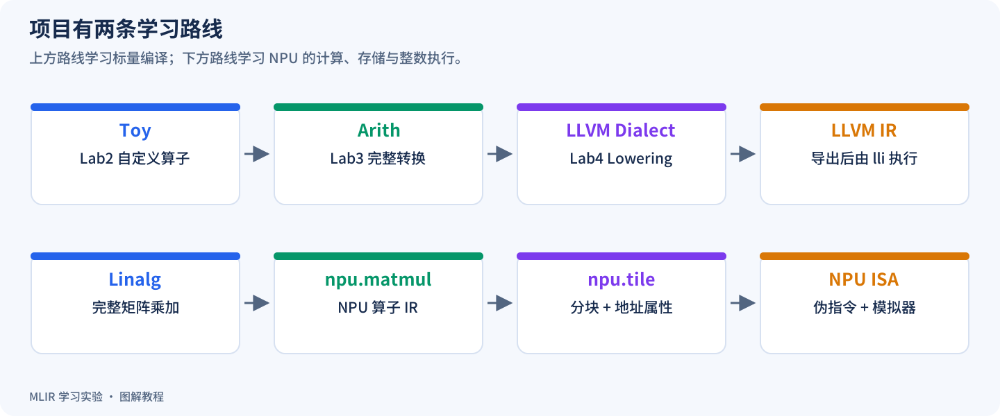

# 从零开始学 MLIR：图解学习路线

这套教程面向第一次接触编译器和 MLIR 的同学。你不需要提前理解 Dialect、SSA、Pass 或量化；教程会在第一次使用时解释。项目已经提供完整代码，学习顺序是：运行 → 观察 → 读懂 → 修改 → 自己验证。

你需要能在终端输入命令，并逐步熟悉 C++ 的变量、函数和类。遇到 C++ 模板写法时，先记住它对应的 MLIR 作用，再回头补语法，不必第一遍就理解每个模板细节。



图 1：Lab2～Lab4 构成标量编译路线；Lab5 是独立的 NPU 编译路线。它们复用知识，但并非把 Toy、LLVM、Linalg、NPU 依次串起来。

## 先准备好学习方式

1. 打开 Ubuntu WSL 终端，执行 `cd ~/projects/mlir-learning`。
2. 每次只打开一个 Lab 的 `TUTORIAL.md`，按顺序复制命令，不复制代码块前的提示符。
3. 同时打开该 Lab 源码；教程提到一个函数，就去源码中找到它。
4. 修改输入时优先保存到 `build/`，保留原始测试作为对照。
5. 每个 Lab 最后先自己回答自测题，再展开参考答案。

`README.md` 是已有实验说明和运行参考；新写的 `TUTORIAL.md` 是面向初学者的逐步课程。两者都保留。

## 按顺序学习

| 顺序 | 图解教程 | 这一课结束后，你应该能做到 |
| --- | --- | --- |
| 0A | [终端、CMake 和第一个 C++ 程序](lab00-cmake-demo/TUTORIAL.md) | 区分源码、配置、编译和运行 |
| 0B | [第一次读懂 MLIR 和 C++ 分析程序](lab00-cpp-analyzer/TUTORIAL.md) | 找到 Operation、Value、Type，统计加法 |
| 1 | [手写加零优化 Pass](lab01-pattern-rewrite/TUTORIAL.md) | 解释匹配、替换和连续重写 |
| 2 | [创建自己的 ToyDialect](lab02-toy-dialect/TUTORIAL.md) | 解释 .td 如何变成可注册的 C++ Operation |
| 3 | [Toy → Arith 的完整转换](lab03-dialect-conversion/TUTORIAL.md) | 区分局部优化与转换合法性 |
| 4 | [组装编译流水线并执行 LLVM IR](lab04-compiler-pipeline/TUTORIAL.md) | 观察多个 Pass 的效果，验证程序结果 |
| 5 | [Mini NPU：从矩阵到伪指令，再到 INT8](lab05-mini-npu-compiler/TUTORIAL.md) | 手算分块、地址、量化，并核对数值 |

Lab5 的 INT8 细节还可以继续阅读 [量化专题](lab05-mini-npu-compiler/INT8_QUANTIZATION.md)。

## 先记住这些词的直观含义

| 名词 | 初次接触时的理解 | 在哪里动手认识 |
| --- | --- | --- |
| 编译器 | 将一种程序表示逐步变成另一种表示的工具 | Lab4、Lab5 |
| IR | 中间表示，描述程序做什么及其数据关系 | Lab00B |
| Operation / Op | 一次操作，例如加法或返回 | Lab00B |
| Value | 操作产生或接收的值，使用者通过它连接起来 | Lab00B |
| Type | 值的表示方式，例如 i32、f32 | Lab00B |
| Dialect | 一组相关操作、类型等定义，类似 IR 的词汇体系 | Lab2 |
| Pass | 在一份 IR 上执行分析或变换的步骤 | Lab1 |
| Pattern | 描述什么局部结构可以改成什么结构的规则 | Lab1 |
| Lowering | 把高层表达逐步变成更接近执行的表达 | Lab3～Lab5 |
| Verifier | 检查 IR 是否满足结构和语义约束 | Lab2 |

不用一次背完。每个概念都要结合输入和输出理解。

## 怎样判断自己学会了

每个 Lab 用四项成果验收：

- 能指出主要源码和程序入口。
- 能画出或解释输入到输出的过程。
- 能独立完成一次小修改，预测结果并验证。
- 能说明一个不应通过的输入为什么失败。

不要仅以“构建成功”作为学习完成的标准。构建成功说明工具跑通，能解释和修改才说明理解了。

## 图片、源码与重新生成

教程配有 35 张概念图。Markdown 使用 PNG，便于编辑器和文档查看器显示；[图片目录](docs/images) 同时保留可放大的 SVG。图中省略的细节会在正文解释，图不能代替源码的精确行为。

只重新生成 SVG 不需要第三方 Python 库：

```bash
python3 scripts/render-learning-diagrams.py
```

重新生成 PNG 还需要 CairoSVG、系统 Cairo 和可用的中文字体：

```bash
python3 scripts/render-learning-diagrams.py --png
```

阅读教程和构建实验无需安装图片生成依赖。已经生成的 PNG、SVG 都随项目提供。

下一步：[Lab00A：终端、CMake 和第一个 C++ 程序](lab00-cmake-demo/TUTORIAL.md)。
