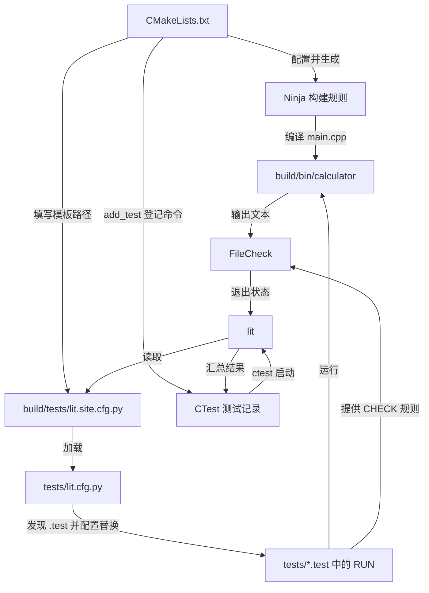

# Lab0：让计算器走完构建与测试流程

本课没有 MLIR、Dialect、Pass。目的只有一个：亲手弄清测试工程里谁调用谁。先完整运行，再逐个拆开。

如果正在阅读 CMakeLists.txt，可以直接跳到[第 9 节：逐条语法讲解](#9-cmakeliststxt-逐条语法讲解)，每条命令都包含通用写法、参数说明和本实验例子。

## 1. 从文件认识角色



图中有两条路线：构建路线生成程序，测试路线运行程序并检查输出。`ctest` 一般不替你构建，修改 C++ 后先重新编译。

## 2. 配置、构建和直接运行

以下命令都在本实验目录执行：

```bash
cd ~/projects/mlir-learning/lab00-calculator-tests
cmake -S . -B build -G Ninja
cmake --build build
./build/bin/calculator add 3 5
```

预期：`result: 8`。`-S .` 是源码目录，`-B build` 是生成文件目录，`-G Ninja` 选择构建工具。配置产生规则，构建才调用 C++ 编译器。

尝试正常与错误输入：

```bash
./build/bin/calculator div -7 2
./build/bin/calculator div 1 0
echo $?
```

依次得到 `result: -3`、`error: division by zero`，最后退出码为 `2`。`echo $?` 必须紧跟要观察的命令。成功结果走 stdout，诊断走 stderr；它们是两个输出通道。

读 `main.cpp`：main 检查参数个数 → parseInteger 检查完整整数及范围 → 根据操作名计算 → 输出结果。`from_chars` 不会自动保证整个字符串都被消费，所以还检查 end。范围限制保证乘法也不会溢出 int64_t。

## 3. 先单独认识 FileCheck

打开 `tests/arithmetic.test`，找到：

```text
# ADD: result: 8
```

手动执行：

```bash
./build/bin/calculator add 3 5 | FileCheck-20 tests/arithmetic.test --check-prefix=ADD --match-full-lines
echo $?
```

成功时 FileCheck 通常不打印内容，退出码为 0。左边提供实际输出，右边的文件提供规则。`--check-prefix=ADD` 只选 ADD 规则；`--match-full-lines` 要求匹配整行，避免把 8 误匹配成 80。

故意提供错误结果，观察诊断：

```bash
printf 'result: 9\n' | FileCheck-20 tests/arithmetic.test --check-prefix=ADD --match-full-lines
echo $?
```

应匹配失败并返回非零。这个操作不修改源码；看完可以重新运行上面的正确命令。FileCheck 只检查文本，不运行计算器，也不计算 3+5。

## 4. 让 lit 自动执行命令

测试文件里完整的一行是：

```text
# RUN: %calculator add 3 5 | %FileCheck %s --check-prefix=ADD --match-full-lines
```

lit 读取 RUN 后进行替换：

| 占位符 | 由谁提供 | 替换内容 |
| --- | --- | --- |
| %calculator | lit.cfg.py | 计算器的绝对路径 |
| %FileCheck | lit.cfg.py | FileCheck 的绝对路径 |
| %python | lit.cfg.py | Python 解释器路径 |
| %s | lit 内置 | 当前 .test 文件的绝对路径 |
| %S | lit 内置 | 当前 .test 文件所在目录 |

沿用本机 LLVM 20 安装路径，直接运行 lit：

```bash
python3 /usr/lib/llvm-20/build/utils/lit/lit.py -sv build/tests
```

预期 4 个测试文件全部通过。加 `-a` 可以显示通过测试的执行信息：

```bash
python3 /usr/lib/llvm-20/build/utils/lit/lit.py -av build/tests
```

看 `tests/lit.cfg.py`：ShTest(True) 执行 Shell 命令；suffixes 只发现 `.test`；substitutions 设置自定义替换；shlex.quote 保护路径中的空格等字符。`.test` 是文本文件，不是 Python 或 C++ 源码。

## 5. CMake 怎样把路径交给 lit

打开模板 `tests/lit.site.cfg.py.in`，再打开生成的 `build/tests/lit.site.cfg.py` 对照：

```python
# 模板中的变量：
config.filecheck = r"@FILECHECK_EXECUTABLE@"
# 生成后会变成你机器上的真实绝对路径。
```

CMake 的 find_program 找工具，configure_file 替换 `@变量@`，生成 site 配置。lit 先读生成配置，再由 load_config 加载源码中的 lit.cfg.py。后者使用前者写入的路径。

生成配置位于 build，因此直接对源码 tests 目录运行 lit 不适合本实验：缺少 site 配置提供的属性。始终使用 `build/tests`。不要直接修改生成文件，下一次配置会覆盖它。

## 6. 最后通过 CTest 统一启动

```bash
ctest --test-dir build -N
ctest --test-dir build -V
```

`-N` 只列出登记的测试，`-V` 显示执行命令及输出。可以看到 CTest 启动 Python 和 lit，lit 再执行测试文件里的 RUN 命令。

为什么 CTest 显示 1 个测试，lit 显示 4 个？因为 add_test 只登记了一次 lit 调用，但 lit 在该调用中发现 4 个 `.test` 文件。每个文件又可以有多个 RUN；本实验共有 17 条。任意必需命令失败都会使相应文件失败，进而使 CTest 的测试组失败。

## 7. 错误输入为什么也能通过测试

看 `tests/errors.test`：除零本来就应该返回 2，因此不能把它当普通成功命令测试。这里先运行 `check_error.py`，检查计算器返回值恰好为 2、stdout 为空，再把 stderr 输出给 FileCheck。

如果计算器错误地返回 0，辅助脚本失败；如果错误文本不对，FileCheck 失败。预期错误被正确处理，整个测试才通过。辅助脚本验证程序行为，不检查计算器的内部实现。

## 8. 亲手修改与验收

1. 在 arithmetic.test 新增一条 `sub 100 25` 测试，使用独立前缀和对应规则。
2. 故意把预期 75 写成 76，运行 CTest，找到失败的 RUN 和实际输出；再改回正确值。
3. 在 main.cpp 增加 `mod`（整数取余），处理除数为零，并加入正常、负数、零除数测试。
4. 修改 C++ 后先构建，再测试；只修改测试规则或源码 lit.cfg.py 时通常直接测试即可。

自测：谁编译 C++？谁读取 RUN？谁读取 CHECK？为什么不需要 .mlir？

参考：编译器由 Ninja 按 CMake 生成的规则调用；lit 读取 RUN；FileCheck 读取 CHECK；测试对象是普通程序，文件后缀由 lit 配置选择。CMake/CTest 不解析这些测试规则。

## 9. CMakeLists.txt 逐条语法讲解

这一节按“通用写法 → 参数含义 → 本实验例子 → 实际作用”阅读。尖括号里的中文是解释用的占位符，不要原样写进 CMakeLists.txt。

先记住几个共用规则：

```cmake
# 井号开始的是注释。
命令名(参数1 参数2 参数3)
```

- CMake 是自己的配置语言，不是 C++；命令后不用加分号。
- 参数可以用空格或换行分开。多行命令仍由同一对括号包住。
- `VERSION`、`LANGUAGES`、`PRIVATE` 等是相应命令识别的关键字，不是你提前定义的变量。
- `${变量名}` 表示读取变量值；设置变量时通常直接写名字。
- `"..."` 把内容作为一个参数传入，尤其适合包含空格的路径。

### 9.1 cmake_minimum_required：规定最低 CMake 版本

通用语法：

```cmake
cmake_minimum_required(VERSION <最低版本>)
```

本实验：

```cmake
cmake_minimum_required(VERSION 3.20)
```

- `cmake_minimum_required`：命令名。
- `VERSION`：后面跟版本号。
- `3.20`：运行本工程需要 CMake 3.20 或更新版本。

这里限制的是 CMake 工具版本，不是 C++ 标准，也不是程序版本。命令同时设置相应的 CMake 策略版本，帮助控制不同版本间的行为差异；入门先理解版本要求即可。

终端执行 `cmake --version` 可以检查本机版本。

### 9.2 project：声明项目名称和使用的语言

通用语法：

```cmake
project(<项目名称> LANGUAGES <语言标识>...)
```

本实验：

```cmake
project(Lab00CalculatorTests LANGUAGES CXX)
```

- `Lab00CalculatorTests`：项目名称，由我们命名。
- `LANGUAGES`：后面列出需要启用的编程语言。
- `CXX`：CMake 对 C++ 的语言标识。CMake 规定用 CXX，不能随意替换为 `C++`。

这一步启用 C++ 编译器检测并建立项目相关变量。项目名称不要求等于文件夹名，也不要求等于可执行程序名称。一个项目可以构建多个程序。

### 9.3 add_executable：定义可执行程序目标

通用语法：

```cmake
add_executable(<目标名称> <源文件1> <源文件2> ...)
```

本实验：

```cmake
add_executable(calculator main.cpp)
```

- `calculator`：构建目标名称；本例没有另外改名，生成程序也叫 calculator。
- `main.cpp`：构建这个目标需要编译的源文件。

配置时这条命令登记目标，不会立即编译。执行 `cmake --build build` 时，构建工具才根据生成规则调用编译器和链接器。

多个源文件可以写成：

```cmake
# 仅演示写法；本实验没有拆分这些源文件。
add_executable(calculator main.cpp add.cpp divide.cpp)
```

也可以换行：

```cmake
add_executable(calculator
  main.cpp
  add.cpp
  divide.cpp
)
```

CMake 也用分号表示列表，例如未加引号的 `main.cpp;add.cpp;divide.cpp` 可以展开成多个源文件。初学建议先使用空格或换行，别把分号误当成 C++ 的语句结束符。

### 9.4 target_compile_features：要求目标具备指定编译特性

通用语法：

```cmake
target_compile_features(<目标名称> <PRIVATE|PUBLIC|INTERFACE> <特性>...)
```

本实验：

```cmake
target_compile_features(calculator PRIVATE cxx_std_17)
```

- `calculator`：前面 add_executable 创建的目标。
- `PRIVATE`：这个要求用于编译目标自身，不向使用该目标的其他目标传播。
- `cxx_std_17`：要求至少具备 C++17 标准所对应的支持，并不强制只能采用 C++17。

这里的 PRIVATE 是 CMake 的使用要求传播范围，不是 C++ 类中的 private 访问权限。三个范围的区别是：

| 范围 | 目标自身使用 | 向依赖者传播 |
| --- | --- | --- |
| PRIVATE | 是 | 否 |
| PUBLIC | 是 | 是 |
| INTERFACE | 否 | 是 |

对本实验这个最终可执行程序，PRIVATE 足够。程序中的整数 `std::from_chars` 和结构化绑定需要 C++17。CMake 在必要时添加对应的编译选项；如果编译器默认标准已满足要求，命令里不一定出现额外的 `-std=`。

### 9.5 set_target_properties：设置程序输出目录

通用语法：

```cmake
set_target_properties(<目标名称> PROPERTIES
  <属性名1> <属性值1>
  <属性名2> <属性值2>
)
```

本实验：

```cmake
set_target_properties(calculator PROPERTIES
  RUNTIME_OUTPUT_DIRECTORY "${CMAKE_CURRENT_BINARY_DIR}/bin/$<0:>")
```

- `PROPERTIES`：后面按“属性名、属性值”成对设置。
- `RUNTIME_OUTPUT_DIRECTORY`：本例中控制可执行程序的输出目录。
- `CMAKE_CURRENT_BINARY_DIR`：CMake 提供的变量，表示当前 CMakeLists 对应的构建目录。
- `${CMAKE_CURRENT_BINARY_DIR}`：读取这个变量，本例独立配置时就是实验目录下的 build。

第一次看可以先想成：

```cmake
RUNTIME_OUTPUT_DIRECTORY "${CMAKE_CURRENT_BINARY_DIR}/bin"
```

因此生成程序放在 `build/bin/calculator`，而不是源码目录。

完整写法末尾的 `$<0:>` 是生成器表达式：它在生成构建规则时求值，并得到空字符串。这里使用它，是为了让多配置生成器也使用统一的 bin 目录，避免自动追加 Debug/Release 子目录。普通 Ninja 是单配置生成器；这属于路径兼容细节，不影响计算器功能。

注意两种语法不同：

```cmake
${变量名}      # 读取变量，通常在配置阶段展开。
$<表达式>     # 生成器表达式，通常在生成构建规则时求值。
```

### 9.6 find_package：寻找 Python 解释器

本实验采用的语法形式：

```cmake
find_package(<包名> REQUIRED COMPONENTS <组件名>...)
```

本实验：

```cmake
find_package(Python3 REQUIRED COMPONENTS Interpreter)
```

- `Python3`：要查找的包；CMake 有用于查找 Python3 的模块。
- `REQUIRED`：找不到必需组件就报错，停止配置。
- `COMPONENTS Interpreter`：需要 Python 解释器，不是 Python 开发头文件和库。

找到后，CMake 把解释器路径放进 `Python3_EXECUTABLE`。之后通过 `${Python3_EXECUTABLE}` 读取它，用来启动 lit。

这里没有把 Python 链接进 calculator；C++ 程序只依赖标准库。find_package 通常是在发现已经安装的依赖，这条命令不会替你安装 Python。

### 9.7 set：创建可通过命令行修改的缓存变量

本实验采用的语法形式：

```cmake
set(<变量名> <默认值> CACHE <类型> <说明文字>)
```

本实验：

```cmake
set(LLVM_TOOLS_ROOT "/usr/lib/llvm-20" CACHE PATH "LLVM tools installation")
```

- `LLVM_TOOLS_ROOT`：我们自定义的变量名。
- `/usr/lib/llvm-20`：默认值。
- `CACHE`：写入构建目录的 CMakeCache.txt，使设置在配置之间保留。
- `PATH`：缓存项的类型，表示目录路径；不会在这里验证目录一定存在。
- `LLVM tools installation`：给人看的说明文字，不是程序执行参数。

例如，LLVM 装在其他位置时可以配置：

```bash
cmake -S . -B build -G Ninja -DLLVM_TOOLS_ROOT=/opt/llvm-20
```

`-D变量名=值` 是 CMake 命令行设置缓存变量的写法。已有缓存值通常不会被上面不带 FORCE 的 set 覆盖，因此命令行设置可以保留下来。

### 9.8 find_program：寻找 FileCheck 和 lit 程序

本实验采用的语法形式：

```cmake
find_program(<保存结果的变量>
  NAMES <候选程序名1> <候选程序名2> ...
  HINTS <提示搜索目录1> <提示搜索目录2> ...
  REQUIRED
)
```

本实验第一处：

```cmake
find_program(FILECHECK_EXECUTABLE NAMES FileCheck-20 FileCheck
  HINTS "${LLVM_TOOLS_ROOT}/bin" REQUIRED)
```

- `FILECHECK_EXECUTABLE`：保存找到的程序路径，例如 `/usr/bin/FileCheck-20`。
- `NAMES`：列出可接受的程序名称。
- `HINTS`：提供额外的搜索位置；不表示只搜索这些目录。
- `REQUIRED`：没有找到就停止配置。

本实验第二处：

```cmake
find_program(LIT_EXECUTABLE NAMES llvm-lit lit lit.py
  HINTS "${LLVM_TOOLS_ROOT}/build/utils/lit" "${LLVM_TOOLS_ROOT}/bin" REQUIRED)
```

逻辑相同，只是候选名称和目录不同。当前环境会找到 LLVM 安装中的 lit.py。后面通过 Python 解释器执行这个脚本。

find_program 不会运行 FileCheck 或 lit，也不会下载安装它们。搜索结果默认进入缓存；更换工具时可以显式指定：

```bash
cmake -S . -B build -DFILECHECK_EXECUTABLE=/opt/llvm-20/bin/FileCheck
```

本实验不调用 find_package(MLIR)，因为计算器既不包含 MLIR 头文件，也不链接 MLIR 库；这里只复用 LLVM 提供的测试工具。

### 9.9 file(MAKE_DIRECTORY)：创建生成配置所需的目录

通用语法：

```cmake
file(MAKE_DIRECTORY <目录1> <目录2> ...)
```

本实验：

```cmake
file(MAKE_DIRECTORY "${CMAKE_CURRENT_BINARY_DIR}/tests")
```

- `file`：CMake 提供的文件操作命令。
- `MAKE_DIRECTORY`：选择创建目录这一功能。
- 后面的路径：本例中是 build/tests。

这条命令在 CMake 配置时执行。目录已存在也可以正常继续。它创建的是构建目录中的 tests，不是源码目录中的 tests。

### 9.10 configure_file：把路径填进 lit 配置模板

本实验采用的语法形式：

```cmake
configure_file(<输入模板> <输出文件> @ONLY)
```

本实验：

```cmake
configure_file(tests/lit.site.cfg.py.in tests/lit.site.cfg.py @ONLY)
```

- 输入相对路径：相对于当前源码目录，因此读取源码 tests 中的模板。
- 输出相对路径：相对于当前构建目录，因此写入 build/tests。
- `@ONLY`：只对 `@变量名@` 这种变量引用进行替换，保留 `${变量名}` 等其他文本，避免意外替换目标语言里的相似语法。

例如模板写：

```python
config.calculator = r"@CMAKE_CURRENT_BINARY_DIR@/bin/calculator"
```

生成配置会变成类似：

```python
config.calculator = r"/home/lzb/projects/mlir-learning/lab00-calculator-tests/build/bin/calculator"
```

这里 CMake 只是填入路径、生成文本，不会执行 Python。`.in` 是常见的模板命名习惯；生成的 `.py` 才是 lit 后面读取的配置。

这一条连接起了两种语言：CMake 在配置时提供路径，Python 配置在测试时使用路径。

### 9.11 enable_testing：开启当前目录及子目录的测试支持

通用语法与本实验相同：

```cmake
enable_testing()
```

没有参数也是合法的命令调用。它开启供 CTest 使用的测试支持；通常在项目顶层调用。CMake 生成的测试描述文件名为 CTestTestfile.cmake，可以在 build 中查看。

它不会启动测试，也不决定怎样解释 RUN/CHECK；测试命令仍然需要下面的 add_test 登记。

### 9.12 add_test：登记 CTest 要执行的命令

本实验采用的语法形式：

```cmake
add_test(NAME <测试名称>
  COMMAND <程序路径> <参数1> <参数2> ...
)
```

本实验：

```cmake
add_test(NAME Lab00-calculator-lit
  COMMAND "${Python3_EXECUTABLE}" "${LIT_EXECUTABLE}" -sv
          "${CMAKE_CURRENT_BINARY_DIR}/tests")
```

- `NAME`：后面跟 CTest 中显示的测试名称。
- `Lab00-calculator-lit`：我们给这组测试取的名字，不是程序路径。
- `COMMAND`：后面依次是可执行程序和传给它的参数。
- `${Python3_EXECUTABLE}`：实际启动的是 Python。
- `${LIT_EXECUTABLE}`：Python 要执行的 lit 脚本路径。
- `-sv`：传给 lit 的选项，不是 CMake 或 CTest 的参数；`-s` 简化进度显示，`-v` 在失败时显示测试命令等详细信息。
- 最后的路径：要求 lit 从 build/tests 读取配置并发现测试。

它登记的命令大致相当于：

```bash
python3 /usr/lib/llvm-20/build/utils/lit/lit.py -sv /实际路径/build/tests
```

配置时只记录这条命令。以后运行 `ctest --test-dir build`，CTest 才执行它；lit 再去读取 `.test` 文件中的 RUN。

这里没有写 Shell 管道，因此 COMMAND 不需要启动一个 Shell 来解析 `|`。`.test` 文件里的管道，是 lit 使用的 Shell 测试格式负责执行的。

## 10. 把这些命令放回时间顺序

| 阶段 | 执行什么 | 产生什么 |
| --- | --- | --- |
| 配置、生成 | cmake -S . -B build -G Ninja | 目标与构建规则、路径配置、CTest 测试记录 |
| 构建 | cmake --build build | Ninja 调用 C++ 编译器和链接器，得到 calculator |
| 测试 | ctest --test-dir build -V | CTest 调用 Python/lit，lit 调用 calculator 和 FileCheck |

可以通过本机 CMake 自带帮助复习某条命令：

```bash
cmake --help-command add_executable
cmake --help-command configure_file
```

阅读时先回答“这条命令在设置哪个对象、什么时候生效”，再看参数，通常比逐字背诵更容易理解。
