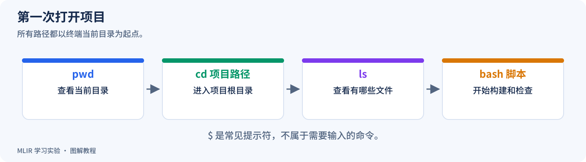
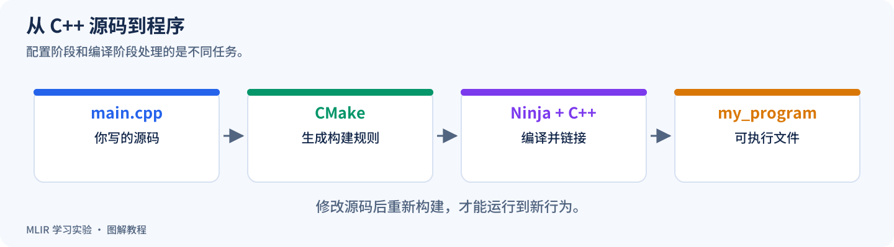
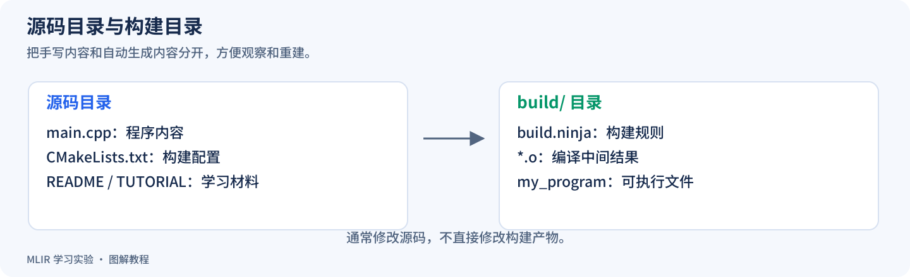

# Lab00A：从终端命令开始，运行第一个 C++ 程序

[返回学习目录](../LEARNING_GUIDE.md) · 下一课：[认识 MLIR](../lab00-cpp-analyzer/TUTORIAL.md)

这一课先解决后续所有实验都需要的问题：源码怎样变成可执行程序，怎样确认你运行的是最新代码。暂时不需要了解 MLIR。

## 第一步：认识终端和目录

终端接收命令，当前目录决定相对路径从哪里开始计算。按顺序输入：

```bash
cd ~/projects/mlir-learning
pwd
ls
```

`cd` 改变目录；`pwd` 打印当前目录；`ls` 列出文件。`~` 表示你的用户主目录，在当前环境中是 `/home/lzb`。



图 1：先确认位置，再运行命令。如果终端显示 `$` 或用户名，那是提示符，通常不用输入。

## 第二步：先把完整实验运行一次

在项目根目录执行：

```bash
bash scripts/build-and-test.sh lab00-cmake-demo
cd lab00-cmake-demo
./build/my_program
```

`bash` 用来执行脚本，后面的 Lab 名称告诉脚本构建哪一个实验。最后一条命令中的 `./` 表示从当前目录查找文件。

预期看到：

```text
Hello CMake and Ninja!
```

脚本也会运行一次程序，因此你可能看到两次问候语。

## 第三步：读懂四个角色



图 2：CMake 负责生成构建规则，Ninja 按规则调度 C++ 编译器。它们不是在执行同一件事。

打开 [main.cpp](main.cpp)：

```cpp
#include <iostream>

int main() {
    std::cout << "Hello CMake and Ninja!" << std::endl;
    return 0;
}
```

`#include` 引入声明，`main` 是程序入口，`std::cout` 向终端输出文字，`return 0` 表示成功结束。后面的 MLIR 工具同样有 main，只是里面会增加解析 IR 和执行 Pass 的逻辑。

## 第四步：读懂 CMakeLists.txt

打开 [CMakeLists.txt](CMakeLists.txt)，逐条对照：

| 写法 | 作用 |
| --- | --- |
| `cmake_minimum_required` | 指定 CMake 最低版本 |
| `project` | 声明项目及使用的语言 |
| `add_executable(my_program main.cpp)` | 将 main.cpp 构建成名为 my_program 的程序 |
| `target_compile_features(... cxx_std_17)` | 要求支持 C++17 |

`my_program` 是构建目标名，不是必须与目录名相同。后面看到 `toy-opt`、`npu-opt` 时，也要区分目录名与可执行文件名。

## 第五步：不依赖脚本，手动配置和编译

以下命令在 `lab00-cmake-demo` 目录执行：

```bash
cmake -S . -B build -G Ninja
cmake --build build -j 2
./build/my_program
```

第一条是配置：`-S .` 指定源码目录，`-B build` 指定构建目录，`-G Ninja` 选择构建工具。第二条才开始构建，`-j 2` 允许最多两个任务同时进行。第三条运行已生成的程序。



图 3：把 build 和源码分开，可以更容易看清哪些文件由你维护，哪些文件由工具生成。

## 第六步：做一个可预测的小修改

1. 在编辑器中把 main.cpp 的问候语改成 `Hello MLIR learner!`，保存。
2. 直接运行 `./build/my_program`，观察仍然是旧输出。
3. 执行 `cmake --build build -j 2`，再运行程序。
4. 这次应该看到新问候语。完成后可以恢复原文字并重新构建。

这一步的关键是：可执行文件不会因为源码保存就自动更新，必须重新构建。

## 常见问题

| 现象 | 先检查什么 |
| --- | --- |
| 找不到 CMakeLists.txt | 用 pwd 确认当前目录，或检查 -S 参数 |
| 找不到 build/my_program | 是否构建成功，是否处于本 Lab 目录 |
| 修改后输出没变化 | 是否保存文件、重新构建，是否运行了正确目录中的程序 |
| 看到 `ninja: no work to do` | 源码未改变时是正常现象 |

## 自测与参考答案

先回答：CMake 和 C++ 编译器各自负责什么？修改 main.cpp 后至少要执行哪两步？build 目录为什么不等于源码目录？

<details>
<summary>展开参考答案</summary>

CMake 生成构建规则，C++ 编译器将源码编译成目标代码，构建过程还需要链接形成程序。修改源码后要重新构建，再运行新的可执行文件。源码目录保存你维护的输入，build 保存根据输入生成的产物。

</details>

你能独立修改问候语、重新构建并解释输出变化后，就可以进入下一课。
