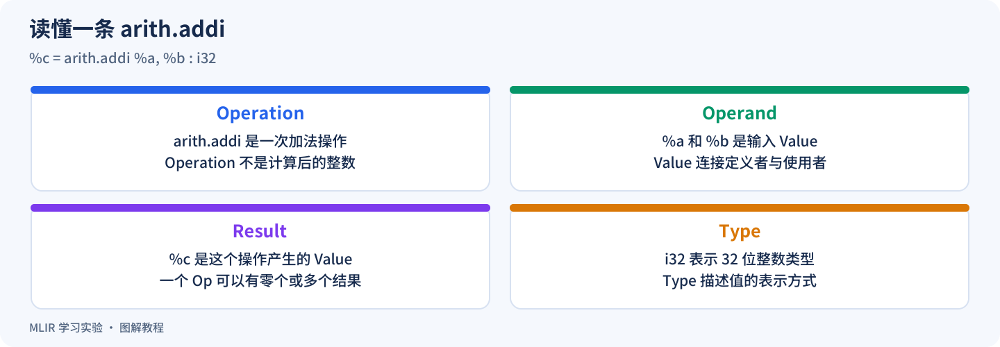
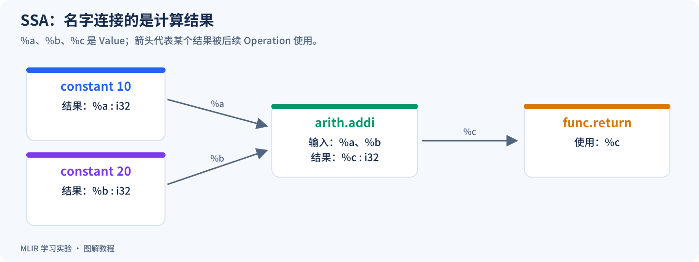
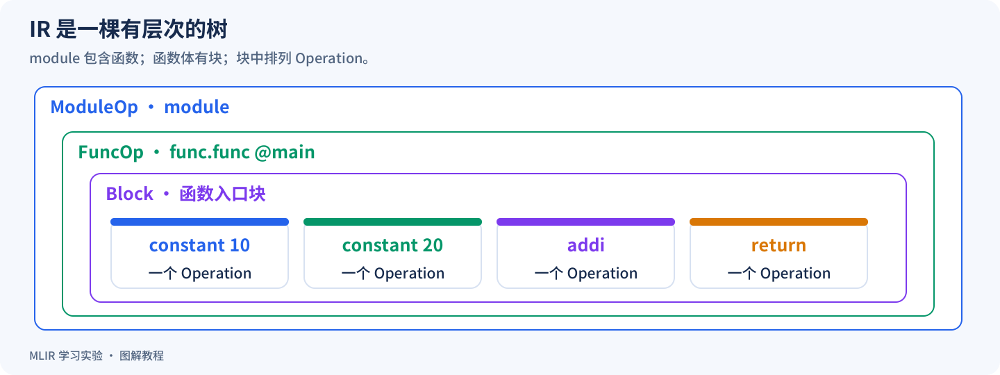
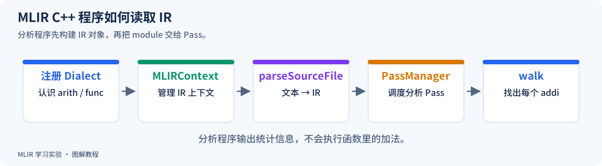

# Lab00B：第一次读懂 MLIR，写出你的 IR 阅读方法

上一课：[CMake](../lab00-cmake-demo/TUTORIAL.md) · [学习目录](../LEARNING_GUIDE.md) · 下一课：[加零优化](../lab01-pattern-rewrite/TUTORIAL.md)

这一课不修改 IR，先认识它。目标是能读懂一条加法，知道 C++ 程序怎样找到它，并解释统计结果。

## 第一步：先理解 IR 是什么

IR 是 Intermediate Representation 的缩写，中文叫中间表示。编译器需要一种能描述计算、数据关系和类型的形式，才能分析和变换程序。MLIR 提供构造这些表示的基础设施。

打开 [test.mlir](test.mlir)，看到：

```mlir
%a = arith.constant 10 : i32
%b = arith.constant 20 : i32
%c = arith.addi %a, %b : i32
```

`arith.constant` 描述常量，`arith.addi` 描述整数加法，`i32` 表示 32 位整数。这里的 `%a` 不是 C++ 变量，而是 IR 中一个值的文本名字。



图 1：Operation 表示操作；输入和结果都是 Value；Type 描述 Value 的表示方式。

## 第二步：理解数据怎样连接起来

SSA 的全称是 Static Single Assignment，可以先理解为“每个 SSA 值只有一个定义”。定义值的 Operation 与使用值的 Operation 通过 Value 连接。



图 2：箭头代表使用关系。把 `%a` 改名为 `%input` 并同步改掉使用处，不会改变计算含义。

函数参数也是 Value，但没有一个普通定义 Operation；它们属于块参数。后续处理未知输入时会看到这种情况。

## 第三步：认识 IR 的嵌套结构



图 3：这是结构的简化示意；test.mlir 实际有两条加法。最外面是 module，里面有 `func.func @main`，函数体入口块中依次排列常量、加法和 return。文本中单块函数的入口块标签可以省略。

MLIR 的一般结构还包含 Region；本例函数体对应一个 Region。先掌握这一个例子，不需要一开始就理解多块控制流。

## 第四步：构建和运行分析程序

```bash
cd ~/projects/mlir-learning
bash scripts/build-and-test.sh lab00-cpp-analyzer
cd lab00-cpp-analyzer
./build/mlir-analyzer test.mlir
```

预期每条加法都输出：两个操作数、一个结果，以及 i32 类型。最后是：

```text
Total arith.addi: 2
```

原函数描述 `(10 + 20) + 20`，但分析程序不会执行它，也不会输出计算结果 50。它输出的是 IR 的结构信息。

## 第五步：从 main 开始阅读 C++

打开 [main.cpp](main.cpp)，按下面的顺序找代码：



图 4：文本先被解析成 IR 对象，之后才会交给分析 Pass。

| 代码 | 初学时应理解的作用 |
| --- | --- |
| `DialectRegistry registry` | 收集工具要认识的方言 |
| `registry.insert<...>()` | 注册 Arith 和 Func |
| `MLIRContext context(registry)` | 创建管理 IR 类型、属性等信息的上下文 |
| `parseSourceFile<ModuleOp>` | 从文件读取并解析 module |
| `PassManager pm(&context)` | 创建管理 Pass 的对象 |
| `pm.addPass(...)` | 加入一个分析步骤 |
| `pm.run(*module)` | 真正执行这些步骤 |

`<...>` 在这些位置是 C++ 模板参数，用来选择具体类型。暂时可以把 `parseSourceFile<ModuleOp>` 理解为“把文件解析成 ModuleOp”。

## 第六步：读懂这个分析 Pass

`AddIOpAnalysisPass` 继承 `PassWrapper<..., OperationPass<ModuleOp>>`。先记住这表示“这个 Pass 的运行对象是一个 module”。`runOnOperation()` 是执行入口，`getOperation()` 取得当前 module。

```cpp
module.walk([&](arith::AddIOp op) {
    addCount++;
    Value lhs = op.getLhs();
    Value rhs = op.getRhs();
    Value result = op.getResult();
});
```

`walk` 遍历嵌套结构。回调参数写成 `arith::AddIOp`，因此这里只处理该类型的加法。`[&](...) { ... }` 是 lambda，可以先把它当成“每找到一条加法，就执行这段小函数”；`&` 使它能修改外层的 addCount。

`op.getLhs()` 返回左侧 Value，不是整数 10。一个 Value 可能来自常量、另一条加法或函数参数，不能直接当成 C++ 整数使用。

## 第七步：只修改输入，验证你的理解

```bash
cp test.mlir build/three-adds.mlir
```

在副本中于 return 前添加 `%e = arith.addi %d, %b : i32`，把 return 改为返回 `%e`。执行：

```bash
./build/mlir-analyzer build/three-adds.mlir
```

预期总数变成 3。这次只改了输入文件，不需要重新编译 C++ 程序。

再把某个 Value 的定义改名却不修改使用处，观察解析失败。随后修复名字，说明错误发生在解析阶段，而不是统计阶段。

## 常见问题与自测

遇到 `Parse failed` 时先看前面的文件名、行号和诊断。修改 C++ 后要构建，修改输入 MLIR 后通常直接重新运行即可。程序当前的统计信息写到标准输出，不是优化后的 IR 文本。

请先回答：Operation 与 Value 有什么区别？为什么 getLhs 不返回数字？为什么输入有两次加法，输出就是 2？

<details>
<summary>展开参考答案</summary>

Operation 描述一次操作，Value 连接操作的输入和结果。getLhs 返回输入 Value，因为它的来源不一定是常量，更不一定在编译时已知。walk 在这个 module 中找到两条 arith.addi，因此计数为 2；这与它们运行时执行多少次是不同的问题。

</details>

学习验收：你能不运行程序就指出两条加法的输入和结果，并预测新增一条加法后的统计输出。
