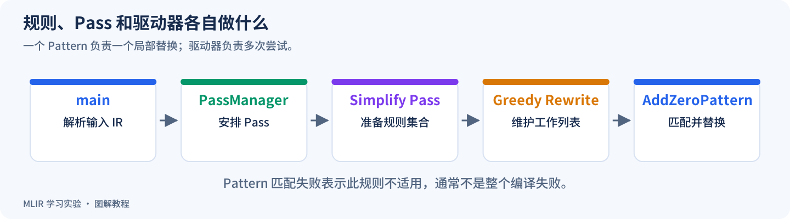
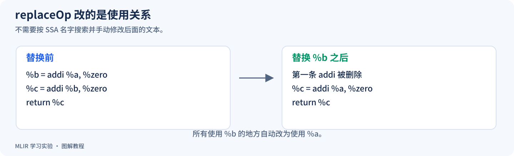
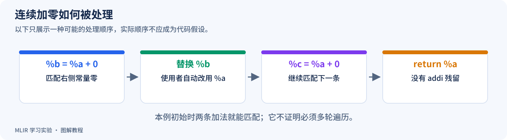

# Lab1：从读 IR 到修改 IR，手写加零优化

上一课：[认识 IR](../lab00-cpp-analyzer/TUTORIAL.md) · [学习目录](../LEARNING_GUIDE.md) · 下一课：[自定义方言](../lab02-toy-dialect/TUTORIAL.md)

这一课实现 `x + 0 → x`。你将认识三个角色：Pass 安排一个处理步骤，Pattern 描述局部改写，Greedy Rewrite 驱动器负责反复尝试规则。

## 第一步：先预测输入输出

打开 [test.mlir](test.mlir)。main 中有两条加零：

```mlir
%b = arith.addi %a, %zero : i32
%c = arith.addi %b, %zero : i32
func.return %c : i32
```

如果 `%zero` 定义为常量 0，第一次加法可以替换成 `%a`，第二次也可以。最终函数只需返回 `%a`。另一个函数中的 `10 + 20` 不满足规则，应保留。


图 1：匹配的是 Value 对应的常量含义，不是 `%zero` 这个名字。当前规则只处理右侧为零，没有额外实现交换律。

## 第二步：运行实验

```bash
cd ~/projects/mlir-learning
bash scripts/build-and-test.sh lab01-pattern-rewrite
cd lab01-pattern-rewrite
mlir-opt-20 test.mlir --verify-each
./build/mlir-pattern-rewrite test.mlir
```

第一条验证输入的 MLIR 命令不会执行自定义 Pass。第二条才运行我们写的优化程序。main 的关键输出是：

```mlir
%c10_i32 = arith.constant 10 : i32
return %c10_i32 : i32
```

SSA 名字变化是正常的。判断成功与否，应看加法是否消失、return 使用的值是否正确。

## 第三步：先分清调用关系



图 2：运行从左向右进入；Greedy 驱动器会调用 Pattern。不要把这几个角色理解成同一个函数。

在 [main.cpp](main.cpp) 中先找到 main 的 `pm.addPass` 和 `pm.run`，再找到 `SimplifyAddZeroPass::runOnOperation`，最后阅读 `AddZeroPattern::matchAndRewrite`。

## 第四步：逐行理解 Pattern

```cpp
struct AddZeroPattern : public OpRewritePattern<arith::AddIOp> {
  using OpRewritePattern<arith::AddIOp>::OpRewritePattern;

  LogicalResult matchAndRewrite(arith::AddIOp op,
                                PatternRewriter &rewriter) const override {
    if (!matchPattern(op.getRhs(), m_Zero()))
      return failure();
    rewriter.replaceOp(op, op.getLhs());
    return success();
  }
};
```

逐个认识这里的 API：

| 写法 | 含义 |
| --- | --- |
| `OpRewritePattern<arith::AddIOp>` | 这条规则处理整数加法 Operation |
| `using ...::OpRewritePattern` | 继承基类构造函数，便于传入上下文 |
| `matchAndRewrite` | 被驱动器调用的匹配与重写入口 |
| `op.getRhs()` | 取出右操作数这个 Value |
| `m_Zero()` | 匹配零常量 |
| `failure()` | 本规则不适用，没有修改 IR |
| `replaceOp` | 用新 Value 替换当前操作的结果，并删除当前操作 |
| `success()` | 规则已成功执行 |

`LogicalResult` 表达成功或失败，不是计算结果。这里的 failure 通常只表示规则不匹配；驱动器会继续处理其他操作。

## 第五步：理解 replaceOp 为什么能影响后面的操作



图 3：IR 对象记录了 Value 的使用关系，不是由程序搜索字符串 `%b` 再改写文本。

执行 `rewriter.replaceOp(op, op.getLhs())` 时，当前 addi 结果的所有使用都会改用 lhs，然后当前 addi 被删除。这同时保证后续使用关系更新，并通知驱动器 IR 发生了修改。

不要通过普通指针随意删除 Operation，也不要手动编辑 SSA 名称来实现这种替换。

## 第六步：理解 Greedy Rewrite



图 4：这里只展示一种可能顺序。驱动器可能先处理另一条加法，正确性不应依赖顺序。

Pass 先创建 `RewritePatternSet`，加入 AddZeroPattern，再冻结为 `FrozenRewritePatternSet`，交给 `applyPatternsGreedily`。驱动器维护待处理的工作列表，在规则修改 IR 后重新考虑相关操作，直到达到不动点或受到配置限制。

不动点可以理解为“继续应用这组规则，IR 已不再改变”。如果没有正常收敛，Pass 使用 `signalPassFailure()` 报告失败。

本例两条加法一开始就都符合规则，一次完整遍历也可能处理完。它验证了连续优化多个 Operation，但不能证明必须多轮遍历。

## 第七步：为什么要关闭 folding

`config.fold = false` 用于关闭驱动器内置的常量折叠。否则 `10 + 20` 也可能被折叠成 30，加零也可能由内置逻辑处理，无法清楚观察自定义规则。

即使关闭 folding，驱动器仍可能清理无用操作。因此加法消失后，已经无人使用的零常量也可能消失。

## 第八步：先跑边界案例，再改规则

```bash
./build/mlir-pattern-rewrite tests/edge-cases.mlir
ctest --test-dir build --output-on-failure
```

请先预测以下函数的结果：参数参与的连续加零应消失；右侧为 1 的加法应保留；`0 + x` 目前保留；名字叫 `%zero` 的未知参数也不能当作常量 0。

独立练习：增加 `0 + x → x`。只在原规则匹配失败之后检查左操作数是否为零，然后替换为右操作数。不要放宽成“只要操作数名字里有 zero 就匹配”。

修改后，原 `zero_on_left` 的 FileCheck 预期也要更新，因为它之前要求保留 addi。测试失败可能表示测试仍在描述旧行为，要结合失败输出判断。

## 常见问题

| 现象 | 原因与检查方向 |
| --- | --- |
| `--simplify-add-zero` 不能作为本程序参数 | 本 Lab 的 main 手动加入 Pass，只接收输入文件名，没有注册这种命令行选项 |
| getLhs 不能与 C++ 数字直接比较 | 它是 Value，不是编译期整数 |
| 10 + 20 意外消失 | 是否打开了 folding 或增加了其他优化 |
| 修改规则后测试失败 | 检查是否破坏原有边界，或是否需要更新改变行为的预期 |

## 自测与参考答案

请解释：一条规则为什么要先匹配再修改？replaceOp 会怎样影响 return？为什么未知参数即使命名为 zero 也不匹配？

<details>
<summary>展开参考答案</summary>

只有证明条件成立才能安全改写；匹配失败时应保持 IR 不变。replaceOp 会更新结果的所有使用，如果 return 使用这个结果，也会自动改为使用替代 Value。SSA 名字不说明数值，函数参数的运行时值没有被证明为零。

</details>

学习验收：能够指出 Pattern、Pass 和驱动器对应的代码，并独立扩展左侧为零的规则及测试。
