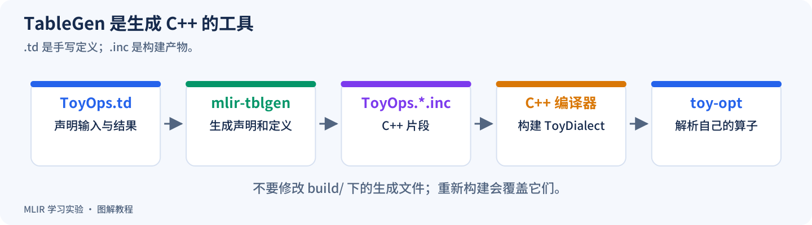
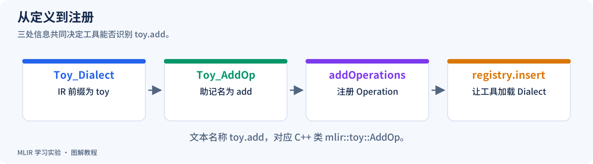
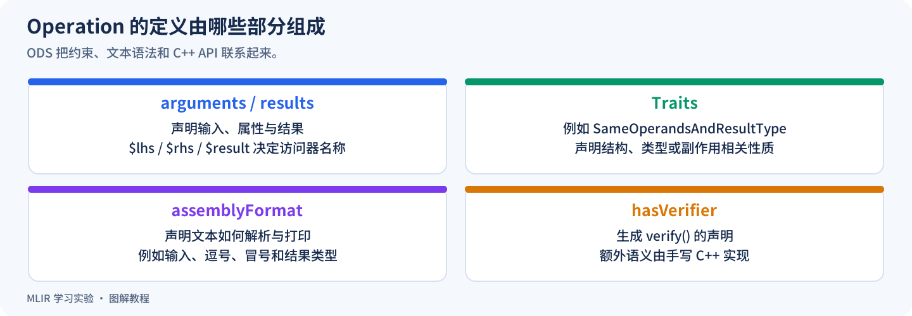
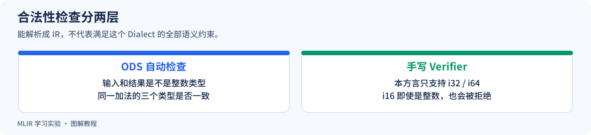
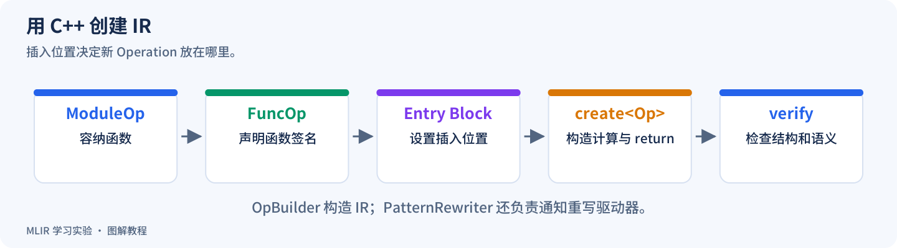

# Lab2：让编译器认识你自己定义的 toy.add

上一课：[Pattern Rewrite](../lab01-pattern-rewrite/TUTORIAL.md) · [学习目录](../LEARNING_GUIDE.md) · 下一课：[Dialect Conversion](../lab03-dialect-conversion/TUTORIAL.md)

前面使用的 arith.addi 由 MLIR 提供。这一课定义自己的词汇体系 ToyDialect，让工具认识 `toy.constant` 和 `toy.add`。本项目的 Toy 是标量整数教学方言，支持 i32/i64，不是官方 Toy 张量教程的完整实现。

## 第一步：从一段自定义 IR 开始

```mlir
%a = toy.constant 10 : i32
%b = toy.constant 20 : i32
%sum = toy.add %a, %b : i32
```

它描述两个整数相加，与前面的 Arith 表达类似。但 MLIR 不会仅凭名字猜出 toy.add 的规则，需要我们定义：它有哪些输入、产生什么结果、允许什么类型、怎样解析和验证。

## 第二步：运行自己的工具

```bash
cd ~/projects/mlir-learning
bash scripts/build-and-test.sh lab02-toy-dialect
cd lab02-toy-dialect
./build/toy-opt test.mlir --verify-each
```

预期输出仍包含 toy.constant 和 toy.add。这一课负责定义和验证，没有做加法优化，也不会打印数值结果 30。

系统自带的 mlir-opt-20 没有链接本方言；这里必须使用自己的 toy-opt。允许未注册方言不能代替正式定义和验证。

## 第三步：TableGen 为什么能生成 C++

TableGen 可以读取声明式定义，并按指定的生成器产生代码。MLIR 用 ODS，也就是 Operation Definition Specification，声明操作的结构和约束。ODS 使用 TableGen 表达。



图 1：`.td` 是输入，`.inc` 是生成的 C++ 片段。`.td` 本身不是由 C++ 编译器直接编译的。

在 [CMakeLists.txt](CMakeLists.txt) 找到 `mlir_tablegen`。`-gen-op-decls` 生成声明，`-gen-op-defs` 生成定义；Dialect 也有对应的声明与定义生成步骤。

构建后执行：

```bash
ls build/Toy*.inc
```

你应该找到四个生成文件。不要直接修改它们，修改手写 .td 后重新构建即可。

## 第四步：定义 Dialect 和 Operation 名称

打开 [ToyDialect.td](include/Toy/ToyDialect.td)：`name = "toy"` 决定 IR 中的前缀，`cppNamespace = "::mlir::toy"` 决定生成类所在的 C++ 命名空间。



图 2：`toy` 与 `add` 组合为文本名称 `toy.add`；对应 C++ 类为 `mlir::toy::AddOp`。

`def Toy_AddOp` 是 TableGen 定义名，不要把它与 IR 文本中的名称混淆。

## 第五步：读懂 Toy_AddOp 的四部分

打开 [ToyOps.td](include/Toy/ToyOps.td)。先看这两行：

```tablegen
let arguments = (ins AnySignlessInteger:$lhs, AnySignlessInteger:$rhs);
let results = (outs AnySignlessInteger:$result);
```

它们声明两个输入 Value 和一个结果 Value，并生成 getLhs、getRhs、getResult 等访问器。`AnySignlessInteger` 是整数类型约束；i32 的 signless 不表示数值只能为非负。



图 3：这些声明共同构成可解析、可访问、可检查的 Operation。

`SameOperandsAndResultType` 要求 lhs、rhs、result 类型相同。`Pure` 表达这个加法没有内存副作用且可推测执行，便于后续优化安全处理；它本身不会把 10+20 算成 30。

`assemblyFormat` 中 `$lhs`、`$rhs` 引用声明的对象，反引号包围要打印的符号，`type($result)` 表示结果类型。因为三个类型相同，文本只需写一次类型。

## 第六步：属性与操作数有什么区别

toy.constant 的 value 是属性，表示编译期直接记录在 IR 上的常量内容。toy.add 的 lhs、rhs 是操作数，表示通过 SSA Value 传入的数据，可能来自常量，也可能来自函数参数。

`AllTypesMatch<["value", "result"]>` 让常量属性的类型与结果一致。因此 `toy.constant 10 : i32` 可以从属性推导结果为 i32。

你可以把属性理解为操作携带的静态说明，把操作数理解为数据流输入；但具体分类仍由 Operation 定义决定。

## 第七步：理解两层 Verifier



图 4：i16 是一个整数，但不在本 ToyDialect 当前支持的位宽范围内。

`hasVerifier = 1` 使生成类声明 verify 方法，具体实现放在 [ToyOps.cpp](lib/ToyOps.cpp)。ODS 负责输入数量、基本类型和一致性，手写 Verifier 进一步要求 i32 或 i64。

```bash
./build/toy-opt tests/invalid.mlir --split-input-file --verify-diagnostics
```

这条命令成功结束，是因为文件中的预期错误全部出现。`--verify-diagnostics` 把错误诊断本身作为测试对象；成功不代表里面每段 IR 都合法。

## 第八步：让 C++ 工具加载这些定义

先读 [ToyDialect.cpp](lib/ToyDialect.cpp)：initialize 中通过 addOperations 注册所有 Operation，`GET_OP_LIST` 从生成文件选择类型列表。

再读 [toy-opt.cpp](tools/toy-opt.cpp)：registry.insert 注册 ToyDialect 和 FuncDialect，MlirOptMain 提供标准命令行、解析、验证和打印。

最后打开 [ToyOps.h](include/Toy/ToyOps.h)：`GET_OP_CLASSES` 表示从生成文件引入类声明。这些宏用来选择代码片段，不是运行时调用。

## 第九步：不用文本，也能通过 C++ 创建 IR



图 5：创建 Operation 时必须有正确的插入位置，否则它可能出现在错误的结构中。

```bash
./build/toy-build
./build/toy-build | ./build/toy-opt --verify-each
```

竖线 `|` 把左侧程序的标准输出交给右侧程序。打开 [toy-build.cpp](tools/toy-build.cpp)：builder.create 使用生成的构造接口，常量结果类型从属性推导，加法结果类型从操作数推导。

程序最后显式 verify，因为构造一个 Operation 并不等于完成了所有语义验证。

## 修改练习与常见问题

本次动手任务：[自己定义并注册 toy.mul](TODO.md)。源码和测试中已标出 `TODO(LAB2-MUL-1)` 到 `TODO(LAB2-MUL-5)` 的填写区域；先完成乘法练习，暂时保持 i32/i64 范围。下面的 i16 扩展作为之后的可选练习。

先复制 test.mlir 到 build/change.mlir，将常量改成 11，运行 toy-opt；输出应保留 toy.add，且常量数值变化。再试负数常量，理解 signless i32 并不禁止负数。

代码练习：让 Verifier 支持 i16，并补一个正例。原先要求 i16 报错的测试也要调整。完成后重新构建，运行 `ctest --test-dir build --output-on-failure`。

如果修改 .td 后没有变化，检查是否重建以及是否运行本 Lab 的工具。如果报 Operation 不认识，沿“定义 → 生成类 → addOperations → registry.insert”逐项查找。

## 自测与参考答案

请解释：.td 和 .inc 分别由谁维护？为什么既要注册 Operation，也要在工具中注册 Dialect？为什么能解析的 i16 仍可能被拒绝？

<details>
<summary>展开参考答案</summary>

.td 由我们维护，.inc 由 TableGen 生成。Dialect 内注册 Operation，告诉该方言有哪些操作；工具注册 Dialect，使上下文能加载该方言。i16 满足基本整数类型约束，但手写 Verifier 限制本方言目前只支持 i32/i64。

</details>

学习验收：能从 toy.add 的文本名称一路追到 ODS、生成类、注册和 Verifier。进一步的文件说明见 [README](README.md)。
