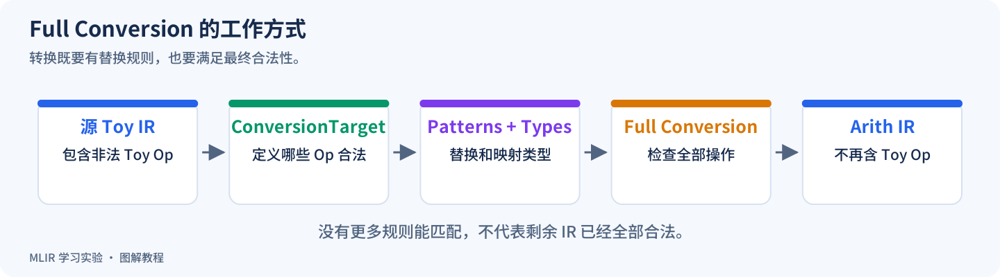
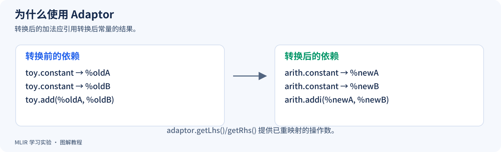
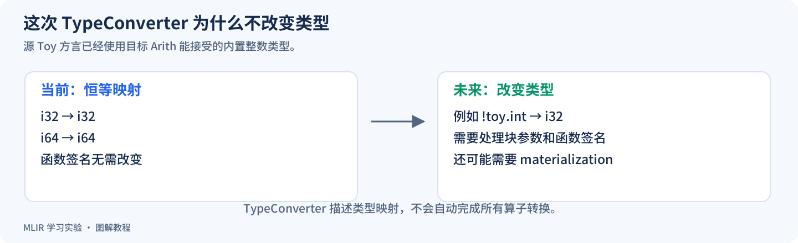
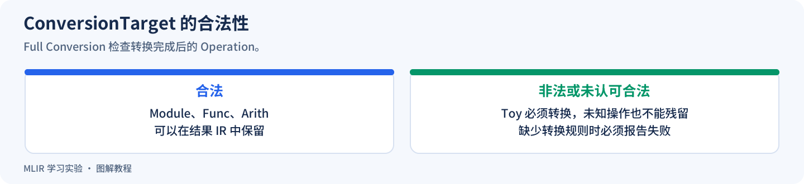

# Lab3：把自己定义的 Toy IR 转换成 Arith IR

上一课：[ToyDialect](../lab02-toy-dialect/TUTORIAL.md) · [学习目录](../LEARNING_GUIDE.md) · 下一课：[编译流水线](../lab04-compiler-pipeline/TUTORIAL.md)

前一课让工具认识 toy.add，这一课让工具知道怎样把它改写为已有的 arith.addi。这是 Lowering 的入门：用另一组表达方式描述同样的计算。

## 第一步：明确这次只做什么

输入包含 toy.constant、toy.add，输出改成 arith.constant、arith.addi。类型和计算含义保持一致。

```mlir
// 输入
%sum = toy.add %a, %b : i32
// 输出中的对应操作
%sum = arith.addi %new_a, %new_b : i32
```

这里 `%new_a`、`%new_b` 表示转换后对应的输入值，不要求打印器实际使用这些名字。转换不等于常量折叠，所以即使加法两侧是常量，也不要求本 Pass 算出结果。



图 1：转换有两个任务：能完成替换，还要确认所有留下的 Operation 都合法。

## 第二步：运行并对照输入输出

```bash
cd ~/projects/mlir-learning
bash scripts/build-and-test.sh lab03-dialect-conversion
cd lab03-dialect-conversion
./build/toy-convert-opt tests/convert.mlir \
  --convert-toy-to-arith --verify-each
```

预期 main 中的两条加法仍保留，但名称已改成 arith.addi。add64 函数也会转换，且保持 i64。

与 Lab1 对比：Lab1 改变局部计算结构来消除加零；本课先改变表示方式，让计算从自定义方言进入 Arith。Lab4 会把这两件事组合起来。

## 第三步：先认识四个工具

打开 [ConvertToyToArith.cpp](lib/ConvertToyToArith.cpp)，找到以下对象：

| 工具 | 直观含义 | 当前项目中的用法 |
| --- | --- | --- |
| ConversionTarget | 结果允许使用的词汇清单 | Module、Func、Arith 合法，Toy 非法 |
| TypeConverter | 类型如何对应 | i32/i64 保持原样 |
| OpConversionPattern | 一类操作的替换规则 | 常量和加法各一条规则 |
| applyFullConversion | 执行并检查完整转换 | 不能残留非法操作 |

OpConversionPattern 是 ConversionPattern 的类型化封装，让你直接取得具体的 Toy Operation，而不是手动判断所有通用 Operation 名字。

## 第四步：先读最短的加法转换规则

```cpp
rewriter.replaceOpWithNewOp<arith::AddIOp>(
    op, adaptor.getLhs(), adaptor.getRhs());
```

这句话创建一个新的 arith.addi，用它的结果替换旧 toy.add 的结果，并删除旧操作。它与 Lab1 replaceOp 的关系是：Lab1 使用已有 Value，本课需要创建新 Operation 后再替换。

## 第五步：为什么要使用 adaptor



图 2：新加法需要连接新常量的结果，不能假设旧输入仍然有效。

`op` 描述待转换的原操作，adaptor 提供已经转换或重映射后的输入。当前类型没有改变，也应养成使用 adaptor 的习惯；后续改变类型时，这一点会更加重要。

常量规则还使用 `adaptor.getValue()` 取得属性，并通过 TypeConverter 取得目标结果类型，再创建 arith.constant。

## 第六步：理解 TypeConverter 的恒等映射

```cpp
TypeConverter types;
types.addConversion([](Type type) { return type; });
```



图 3：恒等映射也是一种类型转换策略，含义是当前源类型已适用于目标表示。

不要把它随意改成“所有类型都返回 i32”。那会涉及函数签名、块参数、返回值及操作约束的一致性，不只是改动一个结果类型。真正转换自定义类型时，还可能需要 materialization，把不同类型的使用边界连接起来。

## 第七步：合法性目标决定什么时候算成功



图 4：这里的未知操作指没有被本 ConversionTarget 认可为合法的操作，并不是所有项目都采用同样策略。

源码中明确将 ModuleOp、FuncDialect 和 ArithDialect 设为合法，将 ToyDialect 设为非法。完整转换结束时，每个相关 Operation 都必须满足目标要求。

Lab1 中没有规则匹配 `10 + 20`，可以正常保留；本课中如果缺少 toy.add 的转换规则，则必须失败，因为 Toy 已经被声明为非法。

## 第八步：观察一次预期的失败

```bash
./build/toy-convert-opt tests/illegal.mlir \
  --allow-unregistered-dialect --convert-toy-to-arith --verify-diagnostics
```

测试要求出现 `failed to legalize operation 'unknown.work'`。允许未注册方言只让解析器接受它，不代表 ConversionTarget 也接受它。

和上一课一样，`--verify-diagnostics` 在预期诊断全部匹配时返回成功。想观察普通失败，可以去掉这个选项，再看诊断和退出码。

## 第九步：认识注册和源码复用

[toy-convert-opt.cpp](tools/toy-convert-opt.cpp) 注册 Toy、Arith、Func 方言，并调用 registerToyConversionPasses。PassRegistration 将这个 Pass 暴露为 `--convert-toy-to-arith` 命令行选项。

Lab3 的 CMake 复用 Lab2 的 ToyDialect 源码；你不需要先手动构建 Lab2。构建系统会处理依赖关系。Lab3 自己生成的依赖构建产物仍放在自己的 build 中。

## 修改练习

先复制 tests/convert.mlir 到 build/change.mlir，把常量 10 改成 12。预测转换后仍是常量 12 加上 0，没有自动变成更短的表达。

代码练习：临时把 `patterns.add<ConvertConstant, ConvertAdd>` 改成只加入 ConvertConstant。重新构建并运行，预期 toy.add 无法合法化。然后恢复规则，再跑：

```bash
cmake --build build -j 2
ctest --test-dir build --output-on-failure
```

这个练习有意制造失败，目的是证明合法性检查确实在起作用。进入 Lab4 前要恢复原代码。

## 自测与参考答案

请解释：为什么 Greedy 可以保留未匹配加法，而本课不能保留 toy.add？adaptor 和 TypeConverter 各解决什么问题？

<details>
<summary>展开参考答案</summary>

Greedy 的成功通常表示规则已不再改变 IR；本 Full Conversion 还要求满足合法性目标，而 Toy 被明确声明为非法。adaptor 提供转换后重映射的输入；TypeConverter 描述类型对应关系。当前类型直接保留，但数据依赖仍然需要正确重映射。

</details>

学习验收：能独立解释一个成功转换和一个合法化失败，并指出对应规则与目标声明。更多运行说明见 [README](README.md)。
