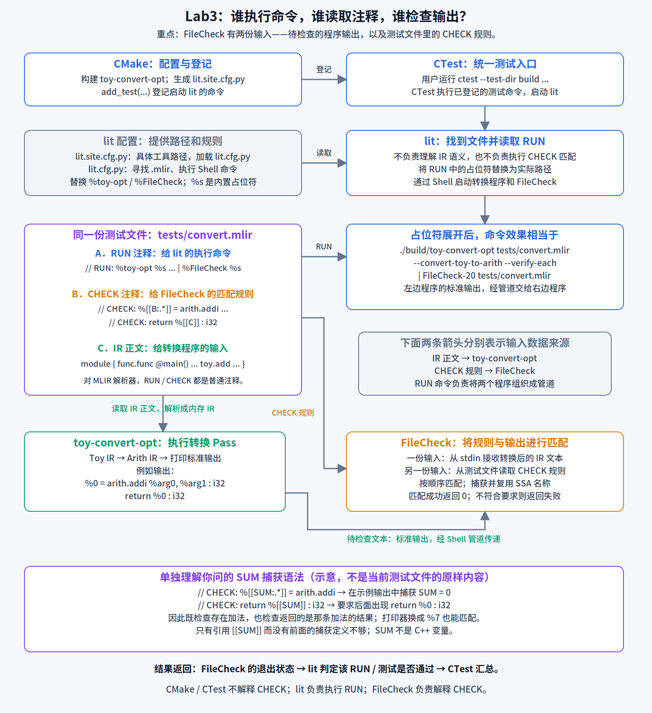
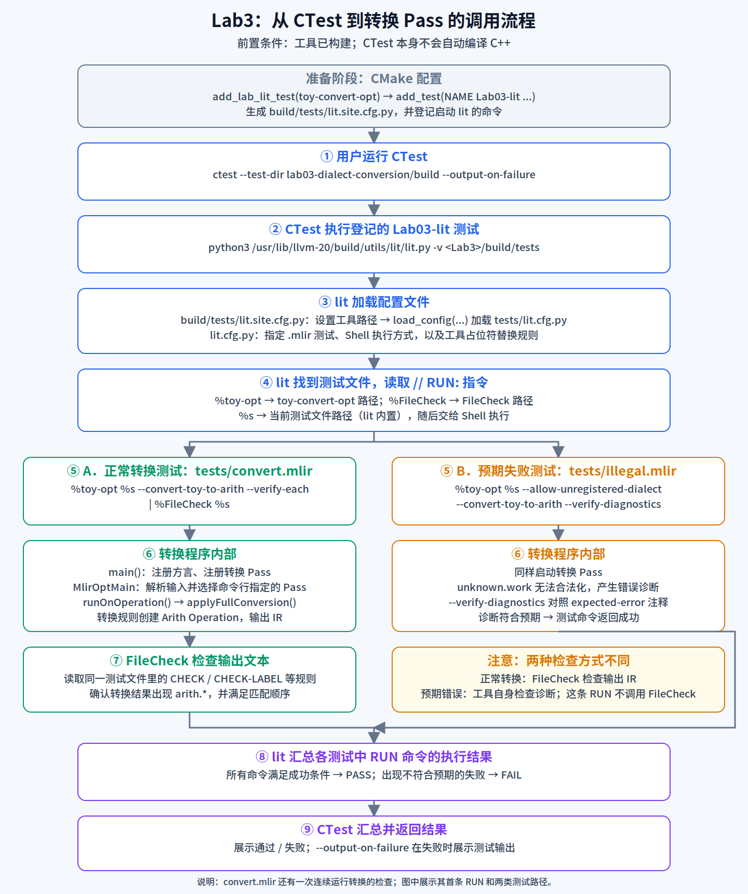

# Lab3：CTest 调用图

## 工具分工、测试文件和数据流



[打开关系图 SVG](test-tools-relationship.svg)。这张图重点说明同一 `.mlir` 文件中的 RUN、CHECK、IR 正文分别由谁读取，以及 FileCheck 同时使用程序输出和检查规则这两份输入。

图底部用 `SUM` 捕获变量单独演示匹配规则；它是语法示意。当前 `tests/convert.mlir` 实际使用 A、Z、B、C 等捕获名，并返回 C。

## 完整测试调用顺序



[打开 SVG 矢量图](ctest-call-flow.svg)。图片根据本项目的 CMake、lit 配置和两个 `.mlir` 测试文件绘制。

测试入口（在项目根目录）：

```bash
ctest --test-dir lab03-dialect-conversion/build --output-on-failure
```

CMake 在配置阶段登记测试并生成环境配置。实际测试时，CTest 启动 lit，lit 加载配置并执行 `RUN` 指令。正常转换测试由 FileCheck 检查输出；非法操作测试使用 `--verify-diagnostics` 核对预期错误，不经过 FileCheck。

`ctest` 不自动构建工具。源码修改后先执行：

```bash
cmake --build lab03-dialect-conversion/build -j 2
```

重新生成 SVG（只需 Python 标准库）：

```bash
python3 lab03-dialect-conversion/diagrams/render_ctest_flow.py
python3 lab03-dialect-conversion/diagrams/render_test_relationship.py
```

额外传 `--png` 可生成 PNG，需要 CairoSVG 和可用的中文字体。阅读已生成的图片不需要安装这些依赖。
