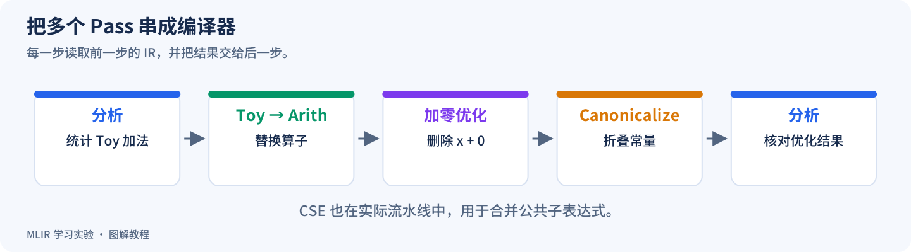
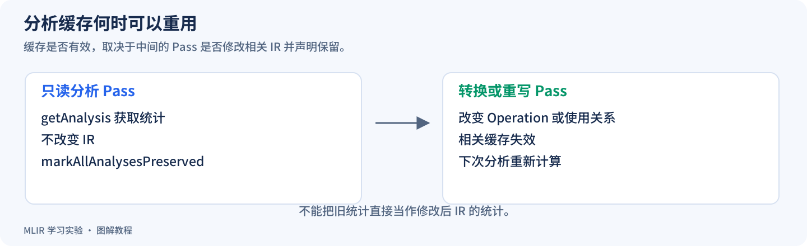
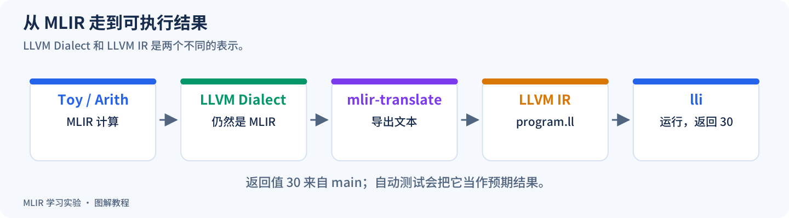
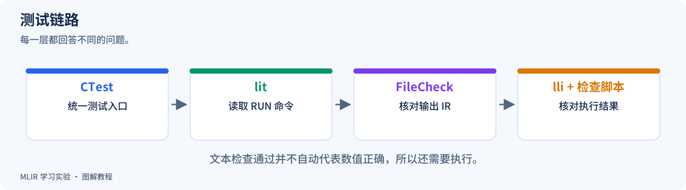

# Lab4：把几个 Pass 组装成可以执行的编译流水线

上一课：[Dialect Conversion](../lab03-dialect-conversion/TUTORIAL.md) · [学习目录](../LEARNING_GUIDE.md) · 下一课：[Mini NPU](../lab05-mini-npu-compiler/TUTORIAL.md)

前面每个实验关注一个能力。这一课将转换、优化、分析、Lowering 和测试连起来，最终执行生成的 LLVM IR。你将第一次看到“一个小编译器”的完整过程。

配套阅读：[实验调用流程图](diagram/README.md)，展示程序入口、流水线注册与构建、Pass 执行，以及分析和改写的内部调用关系。

## 第一步：认识 Pipeline

Pipeline 可以理解为有顺序的处理步骤。前一步的输出 IR，成为后一步的输入。顺序重要：处理 arith.addi 的 Pattern 无法直接匹配 toy.add，因此先做 Toy → Arith 转换。



图 1：实际源码在 canonicalizer 后还运行 CSE。图中重点展示较容易观察的变化。

打开 [tests/pipeline.mlir](tests/pipeline.mlir)，其计算是 `(10 + 20) + 0 + 0`。先预测最后应该得到 30。

## 第二步：运行并分开查看输出

```bash
cd ~/projects/mlir-learning
bash scripts/build-and-test.sh lab04-compiler-pipeline
cd lab04-compiler-pipeline
./build/compiler-opt tests/pipeline.mlir --lab4-optimize \
  --verify-each -o build/optimized.mlir
cat build/optimized.mlir
```

终端显示分析报告，文件显示优化后的 IR。`-o` 指定输出文件。预期 main 只剩常量 30 和 return。

终端程序有两个常见输出通道：标准输出通常承载处理结果，标准错误通常承载诊断或日志。本项目分析报告使用标准错误，因此不会混进输出 IR 文件。

## 第三步：逐步观察 IR 变化

```bash
./build/compiler-opt tests/pipeline.mlir --lab4-optimize \
  --mlir-print-ir-after-all -o build/optimized.mlir
```

这个选项要求在每个 Pass 后打印 IR。不要试图一次读懂所有内容，依次寻找三种变化：toy.add 变成 arith.addi；两条加零消失；剩余常量加法变成常量 30。

Lab1 为单独观察自定义 Pattern 而关闭 folding；Lab4 后续加入 canonicalizer，启用了标准化简。因此本课的 10+20 会消失，这是预期行为。

## 第四步：阅读 Pass 的组合方式

打开 [Pipelines.cpp](lib/Pipelines.cpp) 的 buildOptimizePipeline：

| 调用 | 在本项目中的作用 |
| --- | --- |
| `pm.addPass(...)` | 添加在当前 module 上运行的 Pass |
| `pm.addNestedPass<func::FuncOp>(...)` | 对 module 内的函数安排函数级 Pass |
| `createCanonicalizerPass()` | 使用可用的折叠与标准化简规则 |
| `createCSEPass()` | 合并公共子表达式 |
| `PassPipelineRegistration` | 给这一串 Pass 注册一个命令行名称 |

`OperationPass<func::FuncOp>` 与 `OperationPass<ModuleOp>` 的运行对象不同，不能不考虑结构就交换。嵌套调度使函数级优化运行在正确的层次。

## 第五步：分析缓存到底缓存什么



图 2：分析统计必须与当前 IR 对应，不能把修改前的结果误当作修改后的结果。

OperationCounts 遍历 IR 并统计总操作数、toy.add 数量和 arith.addi 数量。AnalyzePass 使用 `getAnalysis<OperationCounts>()` 请求分析管理器提供结果。

如果缓存仍有效，管理器可以复用；需要时则创建新结果。只读分析通过 markAllAnalysesPreserved 表示它没有破坏任何已有分析。转换和重写改变 IR，会使未被保留的相关分析失效。

示例中，优化前 toy.add 为 3；优化后 toy.add 和 arith.addi 均为 0。

## 第六步：走到 LLVM，但先分清两种表示



图 3：LLVM Dialect 仍在 MLIR 中，LLVM IR 才是导出后的 program.ll 内容。

```bash
./build/compiler-opt tests/pipeline.mlir --lab4-lower-to-llvm \
  --verify-each -o build/lowered.mlir
cat build/lowered.mlir
mlir-translate-20 --mlir-to-llvmir build/lowered.mlir > build/program.ll
```

lowered.mlir 中应看到 llvm.func、llvm.mlir.constant 和 llvm.return。`mlir-translate-20` 再将它导出成 LLVM IR。这里的 `>` 是终端重定向，把标准输出保存到文件。

## 第七步：执行并检查结果

```bash
python3 tests/check_exit.py /usr/bin/lli-20 build/program.ll 30
```

预期：

```text
PASS: LLVM IR executes with exit code 30
```

lli 会执行 LLVM IR 中的 main。它返回 30，而一般终端约定把非零退出状态视为失败；本测试知道 30 是程序的预期返回值，所以专门核对它。

直接在交互终端执行 `lli-20 build/program.ll` 后再执行 `echo $?`，也可看到 30。不要把这种预期非零状态直接放在不处理错误的 `set -e` 脚本里。

## 第八步：读懂测试入口



图 4：结构正确与执行正确都需要验证。

```bash
ctest --test-dir build --output-on-failure
cmake --build build --target check-compiler-opt
```

CTest 提供统一入口；lit 查找测试文件并执行 RUN 注释中的命令；FileCheck 检查输出是否出现或不出现某些内容。

在 pipeline.mlir 中，CHECK-LABEL 定位函数，CHECK 匹配后续文本，CHECK-NOT 检查指定范围内没有不应保留的操作。`%[[C:.*]]` 捕获一个名字，后续 `%[[C]]` 要求使用同一个捕获值。

不要死记打印器生成的 `%0`、`%1` 名称。捕获使用关系能让测试更准确也更稳定。

## 修改练习与常见问题

先复制 tests/pipeline.mlir 到 build/answer42.mlir，调整常量使计算成为 `40 + 2 + 0 + 0`。运行 Lowering、导出 LLVM IR，然后用 check_exit.py 检查返回 42。副本中原有 CHECK 注释不会改变程序语义；如将副本作为正式测试，还需要同步更新预期。

进一步修改源码，暂时去掉 canonicalizer 与 CSE，观察转换和加零之后仍有哪些加法。恢复代码后再运行原测试。

看不到日志时检查是否重定向了 stderr；出现 `failed to legalize` 时检查转换目标与规则；LLVM 导出失败时，先看 lowered.mlir 是否仍含未支持的高层操作。

## 自测与参考答案

请解释：为什么优化顺序重要？分析 Pass 为什么可以声明保留分析？LLVM Dialect 与 LLVM IR 是不是同一份表示？

<details>
<summary>展开参考答案</summary>

每个 Pass 只认识特定操作和结构，所以前序 Pass 必须准备好后序 Pass 的输入。只读分析不修改 IR，已有分析不因它而失效。LLVM Dialect 是 MLIR 中的方言，LLVM IR 是导出后交给 LLVM 工具使用的表示。

</details>

学习验收：能从输入表达式预测结果，在每个 Pass 后找到对应变化，并用执行返回值验证自己的修改。运行参考见 [README](README.md)。
