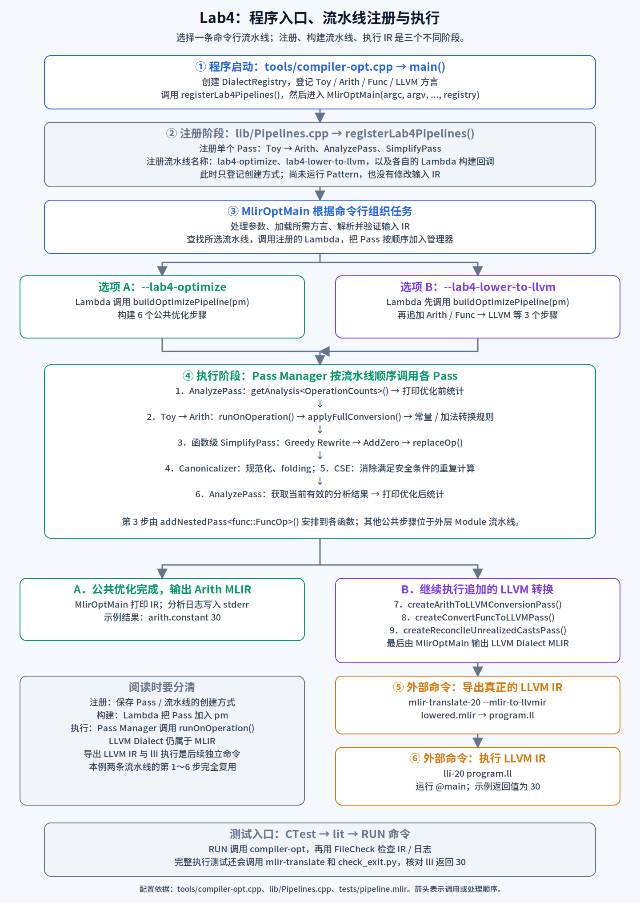
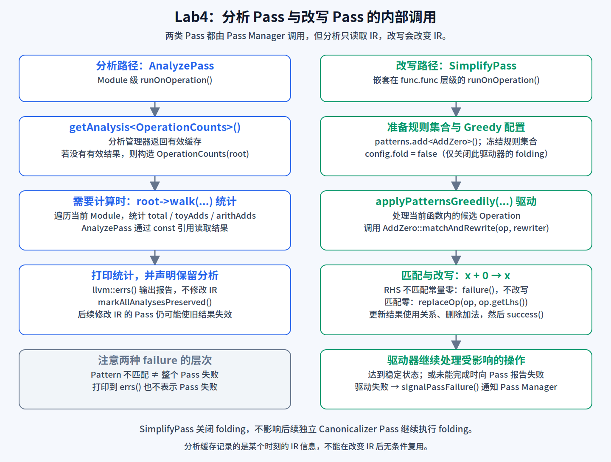

# Lab4 实验调用流程

## 1．从命令行入口到流水线执行



[SVG 矢量图](pipeline-call-flow.svg)。图中展示两条可选流水线：`--lab4-optimize` 和 `--lab4-lower-to-llvm`，以及两者复用的公共步骤。

在 Lab4 目录运行：

```bash
./build/compiler-opt tests/pipeline.mlir --lab4-optimize --verify-each

./build/compiler-opt tests/pipeline.mlir --lab4-lower-to-llvm \
  --verify-each -o build/lowered.mlir
mlir-translate-20 --mlir-to-llvmir build/lowered.mlir > build/program.ll
lli-20 build/program.ll
echo $?
```

最后退出状态为 30，是示例 `main` 的预期返回值。不要在启用 `set -e` 的脚本中不加处理地执行这一步。

对应源码：

| 位置 | 职责 |
| --- | --- |
| [compiler-opt.cpp](../tools/compiler-opt.cpp) | main 注册方言、调用流水线注册函数，进入 MlirOptMain |
| [Pipelines.cpp](../lib/Pipelines.cpp) 的 registerLab4Pipelines | 登记 Pass 与流水线名称、构建回调 |
| 同文件的 buildOptimizePipeline | 将公共的 6 个步骤依次加入 Pass Manager |
| 各 Pass 的 runOnOperation | 真正读取或修改 IR |
| [Lab3 转换实现](../../lab03-dialect-conversion/lib/ConvertToyToArith.cpp) | 提供复用的 Toy → Arith 转换 |

“注册”“构建流水线”“执行”是三个阶段：注册时保存构建方法；命令行选中流水线后调用回调添加 Pass；执行时才调用 Pass 的 runOnOperation。传入 MlirOptMain 的说明文字不决定选择哪条流水线。

## 2．分析与加零优化的内部调用



[SVG 矢量图](pass-detail-flow.svg)。分析结果按需计算和缓存，AnalyzePass 读取并打印；SimplifyPass 则通过 Greedy Rewrite 驱动 AddZero，改写函数内的加法。

## 3．测试如何调用这些步骤

```text
ctest
  → lit 加载配置，读取 .mlir 中的 RUN 指令
  → 调用 compiler-opt 执行上述流水线
  → FileCheck 检查 IR 和分析报告
  → LLVM 执行测试还会导出 LLVM IR
  → check_exit.py 启动 lli，确认返回值为 30
```

结构类似 [Lab3 的 CTest 调用图](../../lab03-dialect-conversion/diagrams/README.md)。实际命令见 [pipeline.mlir](../tests/pipeline.mlir)。

## 图片重建

在项目根目录运行：

```bash
python3 lab04-compiler-pipeline/diagram/render_flow.py
```

默认只用 Python 标准库生成 SVG；额外传入 `--png` 可输出 PNG，需要 CairoSVG 和可用的中文字体。阅读现有图片不需要安装这些依赖。
