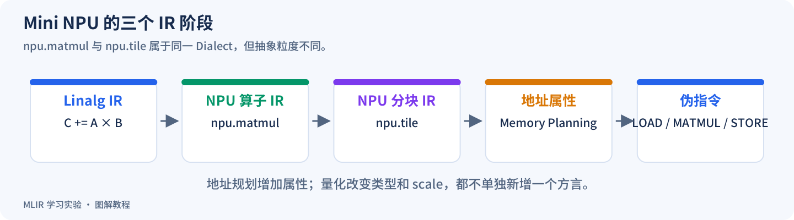
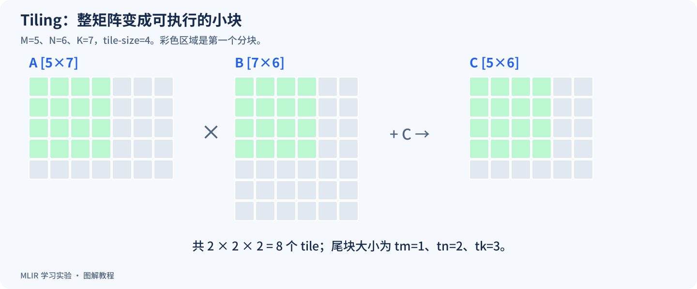
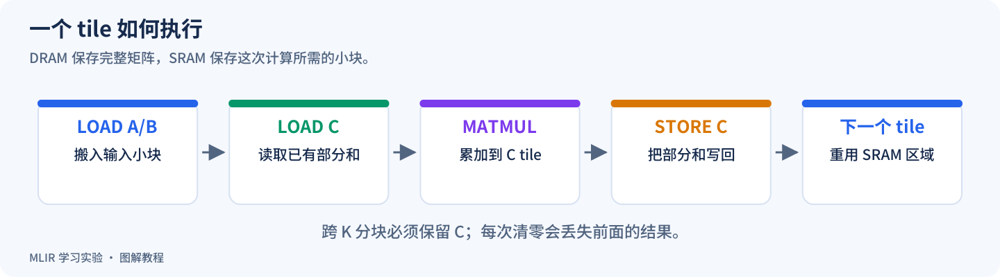
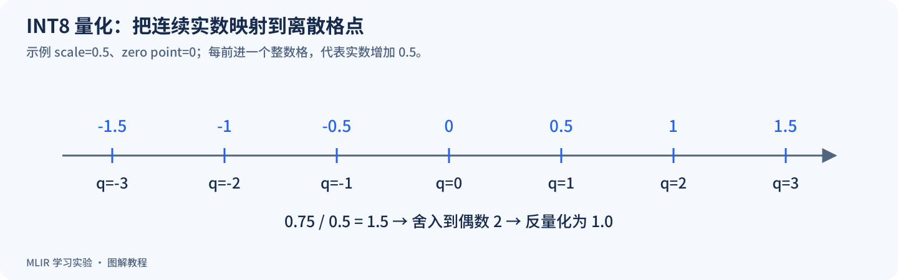

# Lab5：从矩阵乘法到 Mini NPU 编译器，再到 INT8 量化

上一课：[编译流水线](../lab04-compiler-pipeline/TUTORIAL.md) · [学习目录](../LEARNING_GUIDE.md) · [INT8 详细参考](INT8_QUANTIZATION.md)

这是综合项目。建议分三次学习：第一次理解矩阵与 IR；第二次理解分块、内存和指令；第三次理解 INT8。每次都先运行，再对照图片读源码，不必一口气读完。

## 第一部分：先理解要编译什么

### 1. NPU 和这里的“编译器”指什么

NPU 是面向神经网络计算的处理器。本项目没有连接真实硬件，而是定义一个小型软件模型：它有保存完整矩阵的 DRAM、容量较小的 SRAM，以及搬运和矩阵计算指令。

编译器负责把高层矩阵运算变成这个模型能执行的指令；模拟器负责执行这些指令并检查数值。这里生成的是教学伪指令，不是某家芯片的二进制机器码。

### 2. 先读懂矩阵乘加

矩阵是按行、列排列的数。A 的大小为 M×K，B 为 K×N，相乘后的大小为 M×N：

```text
A = [1 2 3]       B = [1 0]
    [4 5 6]           [0 1]
                      [1 1]

A×B = [ 4  5]
      [10 11]
```

左上角是 `1×1 + 2×0 + 3×1 = 4`。K 是每次点积要累加的项数。

本项目实际表达的是 `C += A×B`：把乘积加到 C 已有内容上。如果初始 C 每个元素都是 1，结果就是 `[[5,6],[11,12]]`，不能先把 C 清零。

### 3. 读懂样例的 memref

打开 [examples/matmul.mlir](examples/matmul.mlir)：

```mlir
func.func @matmul(%a: memref<5x7xf32>,
                  %b: memref<7x6xf32>,
                  %c: memref<5x6xf32>) {
  linalg.matmul ins(%a, %b : memref<5x7xf32>, memref<7x6xf32>)
                outs(%c : memref<5x6xf32>)
  return
}
```

`memref<5x7xf32>` 描述一块包含 5 行、7 列、32 位浮点元素的内存。ins 是输入，outs 是输出/累加 buffer；本例 `linalg.matmul` 会读取并修改 C。

这条操作没有 SSA 结果，因为结果通过 C 的内存内容体现。SSA Value 的定义不变，并不意味着它引用的内存内容不能改变。

### 4. 先跑通 FP32 全流程

```bash
cd ~/projects/mlir-learning
bash scripts/build-and-test.sh lab05-mini-npu-compiler
cd lab05-mini-npu-compiler
./build/npu-opt examples/matmul.mlir --npu-compile --verify-each \
  -o build/planned.mlir
./build/npu-translate build/planned.mlir > build/program.npu
python3 simulator.py build/program.npu
```

最后预期出现 `PASS: 5x7 @ 7x6`，最大误差为 0。这个检查使用模拟器生成的数据，后面 INT8 演示会真正量化浮点数据。

### 5. 项目究竟有几个 IR 层次



图 1：按抽象阶段看，有 Linalg IR、NPU 算子 IR、NPU 分块 IR 三个阶段。后两个都属于 NPU Dialect。

Memory Planning 在 tile IR 上增加地址属性，没有新增一个方言。INT8 量化改变类型和 scale，也没有新增独立量化 IR。最后的伪指令是导出格式，不是 MLIR Operation。

## 第二部分：让整矩阵变成能执行的小块

### 6. 逐步观察 Lowering

```bash
./build/npu-opt examples/matmul.mlir --convert-linalg-to-npu \
  --verify-each -o build/npu-matmul.mlir
cat build/npu-matmul.mlir
```

预期 linalg.matmul 变成 npu.matmul。打开 [Passes.cpp](lib/Passes.cpp)，找到 LowerMatmul：它检查标准索引关系和 buffer 条件，再创建对应 NPU 操作。

当前仅支持静态二维、连续行优先、内存空间 0 的矩阵，以及按 A/B/C 顺序传入的三个 buffer。它不会自动完成张量 bufferization，也不会处理任意转置或广播。

打开 [NPU.td](include/NPU/NPU.td)，看到 npu.matmul 和 npu.tile。它们修改 C，不能声明为 Pure，否则后续优化可能误删这些写内存操作。

### 7. 为什么要 Tiling

SRAM 比 DRAM 小，往往不能一次容纳全部矩阵。Tiling 就是把计算拆成多个小块，每次只把需要的数据搬进去。



图 2：示例 M=5、N=6、K=7，tile-size=4，三个方向分别需要 2 个分块，因此共 8 个 tile。

```bash
./build/npu-opt examples/matmul.mlir \
  --convert-linalg-to-npu --npu-tile --verify-each \
  -o build/tiles.mlir
cat build/tiles.mlir
```

第一块从 `(m,n,k)=(0,0,0)` 开始，大小为 `(4,4,4)`。最后一块从 `(4,4,4)` 开始，大小只能是 `(1,2,3)`。如果仍按 `(4,4,4)` 访问，就会越界。

源码用 `min(tileSize, dimension - offset)` 计算尾块大小，是针对本操作手写的静态分块。

### 8. 地址、字节和对齐

一个 f32 元素占 4 字节。因此 A 有 35 个元素，占 140 字节；B 占 168 字节；C 占 120 字节。


图 3：图中框宽不按实际字节数比例绘制。区间之间可能留空，避免下一个 buffer 落在不符合对齐要求的地址。

对齐到 64 可以理解为“向上取到下一个 64 的整数倍”。140 后面最近的 64 倍数是 192，所以 B 从 192 开始；192+168=360，再对齐到 384。

这里的地址是伪指令模型中的内存偏移，不是编译时已经获得的真实 NPU 硬件物理地址。

### 9. SRAM 为什么可以重复使用


图 4：A tile、B tile、C tile 各自占一段区域。当前 tile 完成写回后，下一 tile 可重用这些地址。

这是一种基于明确生命周期的简单内存规划，不是任意神经网络计算图的通用内存分配器。

查看 planned.mlir，可以看到函数参数上的 npu.address、npu.bytes，以及 tile 上的 a_sram、b_sram、c_sram。

### 10. 一条 tile 如何成为指令



图 5：DMA 可以先理解为在 DRAM 与 SRAM 之间搬运数据。这里每一步同步完成，没有异步重叠。

打开 build/program.npu，寻找 LOAD2D、MATMUL、STORE2D：

- LOAD2D：把一个二维小块搬进 SRAM。
- MATMUL：使用 SRAM 中的小块更新 C 小块。
- STORE2D：把更新后的 C 写回 DRAM。

g、s 是字节地址，rows、cols 是行列数，stride 是原矩阵每行跨过的元素数，bytes 是单个元素的字节数。SRAM 中的数据紧凑排列，DRAM 中仍保留全矩阵的行跨度。

尤其注意：每个 K 分块先加载已有 C，再累加并写回。下一 K 分块就能接着已有部分和继续计算。

### 11. 修改一个参数，预测结果

```bash
./build/npu-opt examples/matmul.mlir \
  --npu-compile="tile-size=2 sram-bytes=256" --verify-each \
  -o build/small-tiles.mlir
./build/npu-translate build/small-tiles.mlir > build/small-tiles.npu
python3 simulator.py build/small-tiles.npu
```

tile 变小后数量增加，但计算结果不应改变。M、N、K 三个方向分块数分别为 3、3、4，总数应为 36。

再尝试默认 tile-size=4、sram-bytes=128，应出现容量不足，因为当前 tile 需要 192 字节。

## 第三部分：真正理解 INT8 量化

### 12. INT8 的直观含义

FP32 每个值占 4 字节，可以表示带小数的数；INT8 每个值占 1 字节，只能表示有限范围的整数。量化用 scale 说明“一个整数格代表多少实数”。


图 6：A、B 压缩为 INT8，C 使用 INT32，避免把多个乘积累加到过小的范围中。

本项目量化器使用对称范围 [-127,127]、零点 0；原生有符号 i8 指令还支持 -128。INT32 累加采用模 2^32 回绕，通常的量化推理应通过尺度和数据范围避免最终溢出。

### 13. scale 怎样把实数变成整数

```text
q = clamp(round_even(real / scale), -127, 127)
real_approx = q × scale
```

round_even 表示取最近整数，恰好位于一半时取偶数；clamp 表示超出范围时饱和到边界。



图 7：0.75 / 0.5 = 1.5，取偶数为 2，反量化得到 1.0，产生 0.25 的误差。量化通常是一种近似。

校准是选择 scale 的过程。这里逐张量计算 `max(abs(values))/127`，A、B 各有一个 scale。全零张量选择 scale=1，避免除零。

### 14. 必须把主机量化和编译区分开


图 8：MLIR 只有外部 buffer 参数，编译器看不到参数运行时的所有数据。实际数组由主机侧工具量化；编译器改变函数签名并生成整数计算。

仅把 memref 的 f32 改成 i8，并不能让一块 float 内存自动变成正确整数数据。数据、类型和 scale 必须配套。

### 15. 手算一次带初始 C 的整数乘加

假设 A 的某个值为 0.5，scale_A=0.5，因此 qA=1；B 为 0.75，scale_B=0.25，因此 qB=3。

累加器 scale_C=0.5×0.25=0.125。如果原始 C=0.25，初始 qC=2。计算后 qC=2+1×3=5，反量化为 5×0.125=0.625，正好对应 0.25+0.5×0.75。

C 使用 scale_A×scale_B，而不是任选一个输入的 scale。每个 K 分块期间保留 INT32，不能反复舍入到 INT8 后再累加。

### 16. 运行真实浮点数据演示

```bash
python3 int8_demo.py
```

程序生成真实 FP32 A/B/C，校准 scale，量化数据，调用编译器和模拟器，最后与整数参考和 FP32 参考分别比较。默认 A/B 数据从 308 字节缩小到 77 字节，最大绝对误差约为 0.0476。

查看 build/int8-demo/tensors.json，可以逐个比较原始输入、量化输入、INT32 结果和反量化结果。

如果已有自己的数据：

```bash
python3 int8_demo.py --input examples/quantization-input.json \
  --output-dir build/my-int8
```

JSON 使用扁平行优先数组，m、n、k 指定矩阵形状；不提供 c 时初始值为零。

### 17. 查看 INT8 对内存和指令的影响


图 9：内存规划、DMA 偏移与容量检查都使用真实位宽，不是只把类型名字改掉。

```bash
./build/npu-opt examples/matmul.mlir \
  --npu-compile="quantize-int8=true a-scale=0.125 b-scale=0.25" \
  --verify-each -o build/int8.mlir
./build/npu-translate build/int8.mlir > build/int8.npu
```

结果中 A、B 为 i8，C 为 i32；伪指令出现 MATMUL_I8，A/B 的 LOAD2D 带 bytes=1，C 的读写仍为 bytes=4。

由于 64 字节对齐，4×4×4 tile 的 FP32 与 INT8 SRAM 占用恰好都为 192 字节。8×8×8 tile 才能清晰看到变化：768 字节降到 384 字节。不能只看元素压缩比例，忽略对齐与累加器。

### 18. 两种“正确”分别说明什么


图 10：整数参考完全一致说明指令和分块实现正确；反量化误差描述量化近似对原始计算的影响。

演示对 INT32 溢出进行输出范围检查，并核对舍入误差界。不要仅凭某次误差小就断言所有数据都满足同样精度。

最终 NPU 输出为 INT32，可由主机反量化。需要 INT8 输出时，可调用 quantize.py 的 requantize_int8；当前这一步在主机执行，不是 NPU 定点重定标指令。

## 最后：源码阅读、练习与验收

按顺序打开：NPU.td → NPUDialect.cpp → Passes.cpp → Emitter.cpp → simulator.py → quantize.py → int8_demo.py。先对应概念，不要第一遍逐字读完全部代码。

运行回归检查：

```bash
ctest --test-dir build --output-on-failure
```

当前包括 61 组 FP32 数值检查、63 组 INT8 精确检查，以及真实数据校准、误差界、非法类型、非法 scale 和内存检查。

练习一：手算最后一个 FP32 tile 的 C 全局起点。提示：C 的基地址为 384，起点坐标 m=4、n=4，行跨度为 6，每元素 4 字节。

练习二：保持输入不变，比较 tile-size=2 与 4 的指令数量，并确认结果一致。

练习三：解释为什么 INT8 量化不能只改函数签名，以及为什么不同 K 分块之间不能清零 C。

<details>
<summary>展开参考答案</summary>

练习一：`384 + (4×6+4)×4 = 496`。练习二：分别为 36 个 tile 和 8 个 tile，结果应相同。练习三：实际数据必须按 scale 转换；改变类型不会转换内存内容。跨 K 分块共享同一个输出元素，C 中保存已有部分和，清零会丢失之前的计算。

</details>

这套实现不包含真实硬件接口、动态 shape、逐通道量化或异步双缓冲。掌握当前流程后，可以把它们作为有明确验证方法的后续扩展。实现边界见 [README](README.md)，INT8 细节见 [量化专题](INT8_QUANTIZATION.md)。
