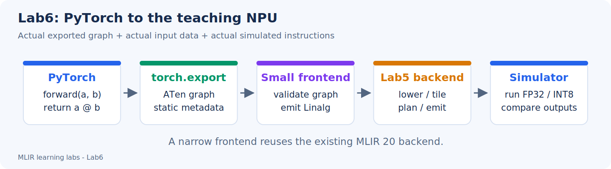

# Lab6：从 PyTorch 矩阵乘法到 Mini NPU

文件结构与职责：[PNG 图](diagrams/file-structure.png) · [可缩放 SVG](diagrams/file-structure.svg)。

面向零基础的逐步讲解见 [图解教程](TUTORIAL.md)。本实验承接 [Lab5](../lab05-mini-npu-compiler/README.md)，完整接入真实的 PyTorch `A @ B` 模型，同时保留 FP32 和 INT8 两条路径。



## 实验目标与实现选择

输入是 `model.py` 中的 `torch.nn.Module` 和两个实际的 CPU FP32 矩阵。通过 `torch.export.export` 捕获真实 ATen 图，验证只有一次矩阵乘法，再生成 Linalg-on-Buffers，调用 Lab5 后端，执行伪指令模拟器，与 PyTorch 结果对照。

本实验使用手写的窄范围 `torch.export → Linalg` 前端，**没有安装或调用 Torch-MLIR**。这让前端代码可以逐行学习，并与当前 LLVM/MLIR 20 后端通过文本 IR 对接。这里没有实现通用的 Linalg-on-Tensors bufferization；未来接入 Torch-MLIR 时仍需完成张量缓冲化及接口适配。

## 一次安装，构建并运行

在项目根目录执行：

```bash
cd ~/projects/mlir-learning
bash lab06-pytorch-to-npu/scripts/setup.sh
bash scripts/build-and-test.sh lab06-pytorch-to-npu
lab06-pytorch-to-npu/build/venv/bin/python lab06-pytorch-to-npu/run.py
```

安装脚本将 CPU PyTorch 2.5.1 和 NumPy 2.2.6 放入 `build/venv`，不修改系统 Python。测试环境为 Ubuntu 24.04、Python 3.12、MLIR 20。优先使用已安装的 `uv`；没有 `uv` 时使用 `python3 -m venv` 和 pip，此时系统需要 `python3-venv`。首次下载依赖需要网络，之后构建运行不需要联网。

CMake 会构建并复用 `../lab05-mini-npu-compiler/build/` 中的后端，不复制方言和 Pass 源码。根目录的全部实验构建脚本已经包含 Lab6；首次运行全部实验前要先执行上面的依赖安装步骤。

预期打印两行 `PASS`，分别对应 FP32 和 INT8。数值误差以本机生成的 `report.json` 为准，FP32 不要求跨 BLAS 实现逐位相等。

也可以显式配置：

```bash
cmake -S lab06-pytorch-to-npu -B lab06-pytorch-to-npu/build -G Ninja \
  -DMLIR_DIR=/usr/lib/llvm-20/lib/cmake/mlir \
  -DLLVM_DIR=/usr/lib/llvm-20/lib/cmake/llvm \
  -DPython3_EXECUTABLE="$PWD/lab06-pytorch-to-npu/build/venv/bin/python"
cmake --build lab06-pytorch-to-npu/build
ctest --test-dir lab06-pytorch-to-npu/build --output-on-failure
```

## 输入和输出

```bash
# 手算示例：[[58, 64], [139, 154]]
lab06-pytorch-to-npu/build/venv/bin/python lab06-pytorch-to-npu/run.py \
  --input lab06-pytorch-to-npu/examples/inputs.json --mode fp32

# 不整除的形状、另一种分块尺寸
lab06-pytorch-to-npu/build/venv/bin/python lab06-pytorch-to-npu/run.py \
  --m 3 --n 5 --k 9 --tile-size 2 --sram-bytes 512 --mode both
```

`--input` 使用嵌套行优先数组 `a`、`b`；提供它时，形状和数据来自 JSON，`--m/--n/--k/--seed` 不再控制输入。默认使用固定随机种子 42 的 5×7 与 7×6 矩阵。

每种模式的输出保存在 `build/demo/fp32/` 或 `build/demo/int8/`：

| 文件 | 内容 |
| --- | --- |
| `model.pt2` | 可通过 `torch.export.load` 重载的导出模型 |
| `exported_graph.txt` | 实际 ATen 图 |
| `abi.json` | M/N/K、布局、A/B/C 顺序、每次调用清零 C 的约定 |
| `01-linalg.mlir` | 前端生成的 FP32 Linalg buffer IR |
| `02-npu.mlir` | 整矩阵 NPU IR |
| `03-quantized.mlir` | 仅 INT8 路径存在，包含量化类型和 scale |
| `04-tiled.mlir` | M/N/K 分块后的 IR |
| `05-planned.mlir` | 带内存地址的 IR |
| `program.npu` | 实际执行的 NPU 伪指令 |
| `tensors.json` | 真实输入、设备输入、模拟器输出和 PyTorch 参考 |
| `report.json` | 模式、形状、版本、误差和验证结果 |

## 源码地图

```text
lab06-pytorch-to-npu/
├── model.py                # 只有 return a @ b 的模型
├── frontend.py             # 导出图检查、静态形状分析、Linalg 生成
├── run.py                  # 调用后端、传实际数据、执行和对照
├── requirements.txt        # CPU Python 依赖
├── CMakeLists.txt          # 复用 Lab5 构建，注册 CTest
├── scripts/setup.sh        # 建立独立环境
├── scripts/render-diagrams.py
├── examples/inputs.json    # 可手算的实际输入
├── tests/run.py            # 正例、反例、数值和 Pipeline 一致性
└── docs/images/            # 5 张 PNG 和 SVG 图解
```

## 接口与支持范围

- 只接受两个用户输入、一个直接输出、一个 `aten.matmul.default` 或 `aten.mm.default`，且计算顺序为 A @ B。
- 输入是 CPU、连续行优先、静态二维 FP32 Tensor，维度为 1..4096；实际案例还受后端 tile 数量和 SRAM 容量限制。
- 不接受参数、持久 buffer、常量状态、动态形状、转置视图、批量矩阵乘法、额外算子和额外输出；不支持训练或自动微分。
- PyTorch 接口返回新 Tensor；Lab5 接口写入第三个输出 buffer。宿主每次分配独立 A/B/C，并将 C 清零，才使 `C += A*B` 等价于 `A @ B`。
- FP32 模式执行真实 FP32 数据，使用 `rtol=1e-4, atol=1e-5` 对比 PyTorch。极端数值可能超出该测试容差；程序会报告失败，不会用参考结果替换输出。
- INT8 模式先从本次实际数据校准，量化 A/B，执行 INT8×INT8→INT32，先与独立整数点积精确比较，再反量化并检查逐元素舍入误差界。这里是输入驱动的教学校准，不是完整模型的离线校准流程。
- 输出是教学伪指令和软件模拟器结果，不是实际 NPU 设备代码，也不是 `torch.compile` 的完整后端注册。

为了逐阶段观察 IR，Lab5 的 `npu-tile`、`npu-plan-memory` 新增与总 Pipeline 一致的单独 Pass 选项：

```bash
lab05-mini-npu-compiler/build/npu-opt --help | rg 'tile-size|sram-bytes'
# 单独调用方式：--npu-tile='tile-size=2' --npu-plan-memory='sram-bytes=512'
```

## 测试内容

`ctest` 调用 Python unittest：覆盖不同 M/N/K、分块尺寸、随机种子、FP32/INT8、零输入、单位矩阵、固定手算结果、导出模型重载、分阶段与完整 Pipeline 一致性；反例覆盖额外算子、交换输入、额外输出、模型状态、动态形状、错误类型、非连续输入、非法尺寸、非有限数据和 SRAM 不足。

## 官方参考

- [PyTorch torch.export](https://docs.pytorch.org/docs/2.5/export.html)：模型捕获和 ExportedProgram。
- [PyTorch 历史版本安装](https://pytorch.org/get-started/previous-versions/)：CPU wheel 安装方式。
- [MLIR Linalg](https://mlir.llvm.org/docs/Dialects/Linalg/)：tensor 和 buffer 形式的结构化计算。
- [Torch-MLIR 架构](https://github.com/llvm/torch-mlir/blob/main/docs/architecture.md)：未来扩展为通用前端时可参考的路径。
