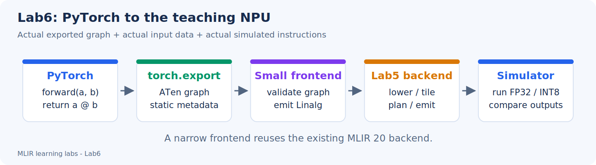
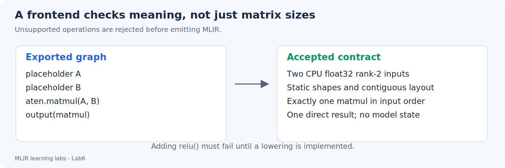
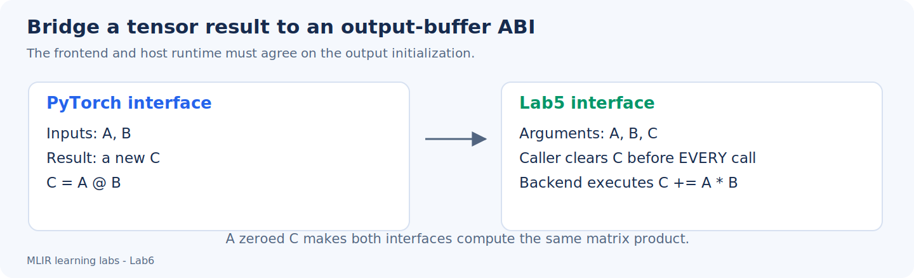
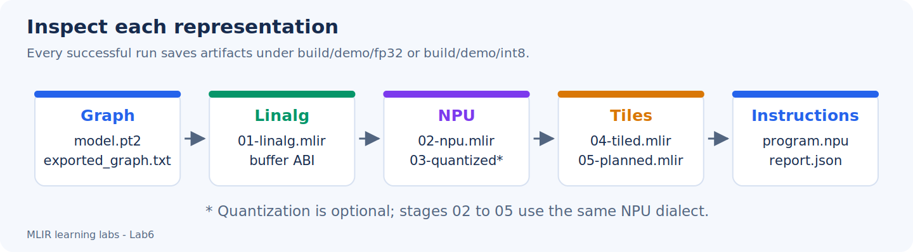
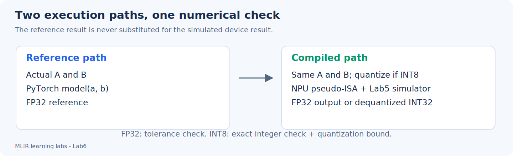

# Lab6 图解教程：让 PyTorch 模型走进你的 NPU 编译器

上一课：[Lab5：Mini NPU](../lab05-mini-npu-compiler/TUTORIAL.md) · [学习目录](../LEARNING_GUIDE.md) · [运行与接口参考](README.md)

这一课面向已经看过 Lab5、第一次接触模型前端的同学。你不需要先掌握 PyTorch 训练：我们只写一个执行矩阵乘法的模型，不训练参数。

学习顺序是：先运行 → 看输入输出 → 看真实计算图 → 看前端 → 看生成的 IR → 看数值验证。不要第一遍就记住全部 API。

## 1．这次补上编译器的哪一段？

Lab5 从手写 `linalg.matmul` 开始；Lab6 从高级语言中的 `return a @ b` 开始。



图 1：先捕获模型，再由小前端翻译成 Lab5 能接收的 IR。右侧仍复用原来的 NPU 后端。

把名词分清：

| 名词 | 这里的含义 |
| --- | --- |
| PyTorch 模型 | 一个 Python 对象，定义输入怎样产生输出 |
| `torch.export` | 捕获模型计算，得到可检查的计算图 |
| ATen Operation | PyTorch 的基础算子，例如 `aten.matmul.default` |
| 前端 | 读取并检查计算图，将支持的计算转换为 IR |
| ABI | 调用约定：参数顺序、类型、输出放在哪里、由谁初始化 |
| 后端 | 将 IR 转换、分块、安排内存并生成目标指令 |
| Runtime | 提供实际数据、执行并取回结果的运行支持；这里由宿主 Python 和模拟器承担 |

本实验手写了一个很小的前端，**不是 Torch-MLIR 的安装教程**。我们真正使用 PyTorch 导出的计算图，但只实现“一次静态二维矩阵乘法”这一个子集。这样你能看清每一步，并继续使用 MLIR 20。

## 2．安装、构建和第一次运行

在 WSL 终端执行：

```bash
cd ~/projects/mlir-learning
bash lab06-pytorch-to-npu/scripts/setup.sh
bash scripts/build-and-test.sh lab06-pytorch-to-npu
lab06-pytorch-to-npu/build/venv/bin/python lab06-pytorch-to-npu/run.py
```

这三步分别是：

1. 在 Lab6 的 `build/venv` 建立 Python 环境，安装 CPU PyTorch 和 NumPy。
2. 构建复用的 Lab5 后端，并运行 Lab6 测试。
3. 捕获模型，编译并实际运行 FP32、INT8 两种伪指令程序。

无需 CUDA 或 NVIDIA GPU。首次安装需要下载依赖；如果使用系统自带 venv 遇到缺少 `ensurepip`，先安装 Ubuntu 的 `python3-venv`，或者使用 `uv`。

应该看到两行：

```text
PASS: fp32, max_abs_error=...
PASS: int8, max_abs_error=...
```

本次验证环境中默认样例 FP32 最大绝对误差为 0，INT8 反量化后约为 0.04421。误差值是观测结果，不是跨所有版本和输入的固定常量。

`PASS` 不仅表示“编译成功”，还表示模拟器算出的实际结果通过了数值检查。

## 3．先用可以手算的输入

```bash
lab06-pytorch-to-npu/build/venv/bin/python lab06-pytorch-to-npu/run.py \
  --input lab06-pytorch-to-npu/examples/inputs.json --mode fp32
```

输入是：

```text
A = [[1, 2, 3],       B = [[ 7,  8],
     [4, 5, 6]]           [ 9, 10],
                          [11, 12]]
```

A 是 2×3，B 是 3×2，因此结果是 2×2：

```text
C = [[ 58,  64],
     [139, 154]]
```

例如左上角：`1×7 + 2×9 + 3×11 = 58`。

打开 `lab06-pytorch-to-npu/build/demo/fp32/tensors.json`，比较 `output` 和 `pytorch_reference`。前者来自伪指令执行，后者来自 PyTorch。

注意这个命令会覆盖默认 FP32 演示目录；希望保留多组结果时，加 `--output-dir lab06-pytorch-to-npu/build/known-answer`。

## 4．逐行认识模型 model.py

```python
import torch

class MatmulModel(torch.nn.Module):
    def forward(self, a, b):
        return a @ b
```

`import torch`：引入 PyTorch。

`class MatmulModel(torch.nn.Module)`：定义一个类，继承 PyTorch 的模型基类。和 C++ 中的继承概念相通，但 Python 使用冒号和缩进表示代码块。

`def forward(self, a, b)`：定义模型的前向计算。`self` 是当前对象，a、b 是输入。

`a @ b`：Python 的矩阵乘法运算符。对于本实验的二维 Tensor，执行矩阵乘法；不是逐元素相乘，逐元素乘法使用 `*`。

外部调用：

```python
model = MatmulModel()
result = model(a, b)
```

PyTorch 会通过 Module 的调用机制进入 `forward()`。这个模型没有可训练权重，也没有模型状态；a 和 b 都来自调用者。

## 5．捕获真实计算图，而不是根据形状猜模型

打开 `frontend.py` 的 `export_model()`：

```python
program = torch.export.export(model.eval(), (a, b), strict=True)
return program, analyze_exported(program)
```

`model.eval()` 将模型设为评估模式；它本身不是关闭梯度的操作。

`(a, b)` 是 Python 元组，表示提供给模型的两个示例输入。

`torch.export.export(...)` 捕获实际运算，返回 `ExportedProgram`，包含计算图、输入输出签名、形状类型信息等。

`strict=True` 选择严格捕获模式；它并不意味着任意模型都能被本实验编译，我们还要检查计算图。

可以查看实际图：

```bash
cat lab06-pytorch-to-npu/build/demo/fp32/exported_graph.txt
```

通常会看到类似结构：

```text
placeholder a
placeholder b
call_function torch.ops.aten.matmul.default(a, b)
output (matmul,)
```

节点名称可能随版本变化，所以前端检查节点的操作类型、目标和连接关系，而不是硬编码某个节点名称。



图 2：除了读取形状，前端还检查“模型确实只做一次 A @ B”。

## 6．为什么一定要检查计算图？

假设把模型改为：

```python
return (a @ b).relu()
```

输出形状仍然可以是 M×N，但计算含义已经改变。如果只根据输入形状生成矩阵乘法，就会静默丢掉 ReLU，得到错误的编译器。

因此 `analyze_exported()` 检查：

- 只有两个用户输入、一个输出，没有权重、buffer 等状态。
- 图只包含两个输入节点、一个矩阵乘法节点和一个输出节点。
- 乘法必须使用 A、B 的原始顺序，结果直接返回。
- 类型是 CPU FP32，形状为静态二维，布局连续。
- 输出形状与矩阵乘法关系一致。

不支持的计算会明确报错。扩展一个算子时，必须同时扩展“检查、生成和测试”，不能只放宽检查。

Python 中的 `@dataclass(frozen=True)` 用于简化 `MatmulSpec` 这种数据容器的定义。它只保存 M、N、K，是前端分析结果，不是新的 MLIR Dialect。

## 7．从图变成 Linalg IR

`emit_linalg(spec)` 根据验证通过的矩阵乘法生成：

```mlir
module {
  func.func @matmul(%a: memref<2x3xf32>,
                    %b: memref<3x2xf32>,
                    %c: memref<2x2xf32>) {
    linalg.matmul
      ins(%a, %b : memref<2x3xf32>, memref<3x2xf32>)
      outs(%c : memref<2x2xf32>)
    return
  }
}
```

这里使用 Python 格式化字符串输出 MLIR 文本，再由 Lab5 的真实 MLIR 解析器和 Verifier 读取。因为操作种类固定、尺寸已校验，不需要给每个输入样例手写一个 IR 文件。

与 Lab2 的 `OpBuilder` 相比，这里选择文本作为 Python 前端与 C++ 后端的接口，避免额外安装 MLIR Python 绑定。真正的 NPU lowering、分块和内存规划仍由 C++ Pass 完成。

重要边界：没有先生成 tensor 形式再运行通用 bufferization；这里直接把已验证的单个矩阵乘法映射为固定 buffer 接口。

## 8．为什么多出第三个参数 C？

PyTorch 接口是：

```text
输入 A、B → 返回新结果 C
```

Lab5 接口是：

```text
传入 A、B、C → 在 C 的内存中累加结果
```



图 3：我们不是给返回值改个名字，而是改变了函数的调用约定。

因为 Lab5 的语义是 `C += A×B`，宿主必须在**每次调用前**准备零初始化的 C：

```python
initial_c = [0] * (spec.m * spec.n)
result = simulator.execute(isa, [input_a, input_b, initial_c])[0]
```

`[0] * 数量` 创建对应长度的全零列表；矩阵按行展开。

`execute(...)` 将实际数据装入模拟器并执行指令。传入的 C 如果不为零，结果就会叠加旧数据，不再等价于 PyTorch 的 `a @ b`。

`abi.json` 记录了这个约定。将来换成真正设备 Runtime 时，也要遵守它；仅把 `01-linalg.mlir` 单独拿走，不会自动获得清零行为。

## 9．逐阶段观察 Lab5 后端



图 4：这些文件是同一次编译逐步生成的结果，便于对照阅读。

| 文件 | 观察重点 |
| --- | --- |
| `01-linalg.mlir` | 通用的完整矩阵乘法 |
| `02-npu.mlir` | `linalg.matmul` 变成 `npu.matmul` |
| `03-quantized.mlir` | 可选：A/B 变为 i8，C 变为 i32，增加 scale |
| `04-tiled.mlir` | 一个整矩阵变成多个 `npu.tile` |
| `05-planned.mlir` | 增加全局内存和 SRAM 地址属性 |
| `program.npu` | 搬运和矩阵计算指令 |

可以执行：

```bash
cat lab06-pytorch-to-npu/build/demo/fp32/01-linalg.mlir
cat lab06-pytorch-to-npu/build/demo/fp32/04-tiled.mlir
cat lab06-pytorch-to-npu/build/demo/fp32/program.npu
```

再运行一个有边界块的例子：

```bash
lab06-pytorch-to-npu/build/venv/bin/python lab06-pytorch-to-npu/run.py \
  --m 3 --n 5 --k 9 --tile-size 2 --sram-bytes 512 \
  --output-dir lab06-pytorch-to-npu/build/remainders
```

这里 A 是 3×9，B 是 9×5。分块数为：

```text
ceil(3/2) × ceil(5/2) × ceil(9/2) = 2 × 3 × 5 = 30
```

打开 `04-tiled.mlir`，检查最后的块尺寸为什么比 2 小。

## 10．INT8 路径到底多做了什么？

```bash
lab06-pytorch-to-npu/build/venv/bin/python lab06-pytorch-to-npu/run.py --mode int8
```

程序复用 Lab5 的量化函数：

```text
实际 FP32 输入
    ↓ 按本次数据最大绝对值确定 scale
量化为 INT8
    ↓ 编译 INT8×INT8→INT32 指令
模拟器执行，取得 INT32
    ↓ 乘以 scaleA × scaleB
反量化为浮点结果
```

本实验量化零点为 0；全零输入使用安全的默认 scale。校准针对本次输入，不是完整模型的通用量化训练或校准系统。

INT8 误差不为零是正常现象，但必须检查两件事：

1. INT32 结果与独立的整数矩阵乘法完全相同，确认编译、搬运和执行没有算错。
2. 反量化结果与 PyTorch 的差异在逐元素量化舍入误差界内。

不能只看到两份结果“大概差不多”就认为编译器正确。

## 11．为什么 FP32 也要允许很小的误差？

PyTorch 的 CPU 矩阵乘法通常调用优化的数值库；模拟器逐项执行乘法、加法并分别舍入为 FP32。累加顺序或融合乘加的差异，都可能产生末位误差。



图 5：两个路径读取同一份输入，独立计算，最后比较。

`run.py` 的 FP32 检查是：

```python
torch.testing.assert_close(actual, reference, rtol=1e-4, atol=1e-5)
```

`actual` 来自模拟器，`reference` 来自 PyTorch。超出容差时会报错，不会把参考答案当作设备输出返回。

## 12．运行测试并读懂成功的含义

```bash
ctest --test-dir lab06-pytorch-to-npu/build --output-on-failure
```

想直接看到每个 unittest 名称：

```bash
lab06-pytorch-to-npu/build/venv/bin/python lab06-pytorch-to-npu/tests/run.py \
  --backend-dir "$PWD/lab05-mini-npu-compiler/build" \
  --output-dir "$PWD/lab06-pytorch-to-npu/build/tests"
```

CTest 显示一组测试，是因为它调用一个 Python 脚本；脚本内部运行 10 个测试方法，其中包含多组形状、随机种子和反例子测试。

特别留意 `test_reject_unsupported_models`：它通过，表示 ReLU 等不支持的模型被正确拒绝，不表示已经支持 ReLU。

## 13．常见问题

| 现象 | 原因与处理 |
| --- | --- |
| `No module named torch` | 使用了系统 Python；改用 `build/venv/bin/python` |
| CMake 找不到 PyTorch | 先 setup；如果已有旧缓存，用 `-DPython3_EXECUTABLE=...` 指定环境 |
| 找不到 `npu-opt` | 先运行构建脚本；自定义后端目录时用 `--backend-dir` |
| `only a single matrix multiplication ...` | 图含额外操作；当前前端只支持一次矩阵乘法 |
| `contiguous rank-2` | 输入不是连续二维 Tensor，例如转置视图或 batch 输入 |
| `tile exceeds SRAM capacity` | 分块太大或容量太小；减小 `--tile-size` 或增大容量 |
| INT8 有小误差 | 量化舍入所致；检查整数精确对照和误差界是否通过 |

## 14．练习与自测

先完成三个不需要改后端的练习：

1. 修改 JSON 输入，手算一个结果，并在 `tensors.json` 中核对。
2. 固定相同输入，将 tile-size 从 4 改成 2，比较指令数量与输出。
3. 把模型改成 `(a @ b).relu()`，观察前端在哪里拒绝它，然后恢复代码。

再尝试一个设计练习：如果未来支持返回结果的新 Tensor，但不让调用者清零 C，你需要把初始化安排在哪一层？是否需要扩展后端支持 `fill` 或清零指令？先画流程，再修改代码。

<details>
<summary>自测答案：为什么不能只读取输入形状就输出 linalg.matmul？</summary>

同样形状的模型可能做加法、乘法、ReLU 或交换输入。必须检查运算种类和图中的数据连接，才能保证编译保持语义。
</details>

<details>
<summary>自测答案：这个实验使用了 Torch-MLIR 吗？</summary>

没有。它使用真正的 torch.export 捕获图，然后通过手写的单算子前端直接生成 Linalg buffer IR。接入通用 Torch-MLIR 的 tensor IR，还需要 bufferization、算子覆盖和函数接口适配。
</details>

<details>
<summary>自测答案：哪些工作由 Lab6 做，哪些仍由 Lab5 做？</summary>

Lab6 定义模型、捕获和验证图、适配 buffer ABI、提供实际数据并与 PyTorch 对照。Lab5 继续负责 NPU lowering、量化类型变换、分块、内存规划、指令生成，以及模拟器执行和宿主量化辅助函数。
</details>

验收标准：你能从 `return a @ b` 开始，解释每一个中间文件的来源，并说明为什么必须清零 C、为什么不支持的算子不能静默跳过。
